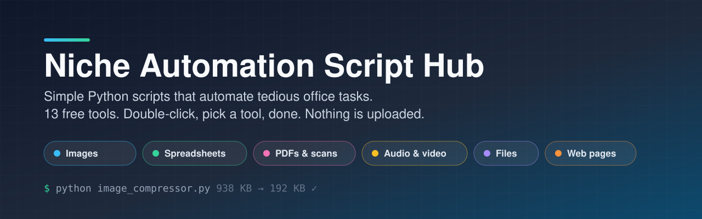
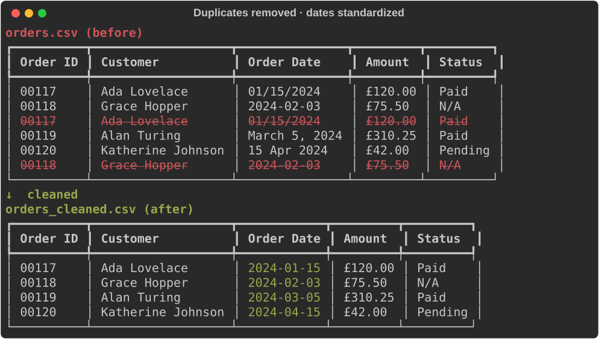
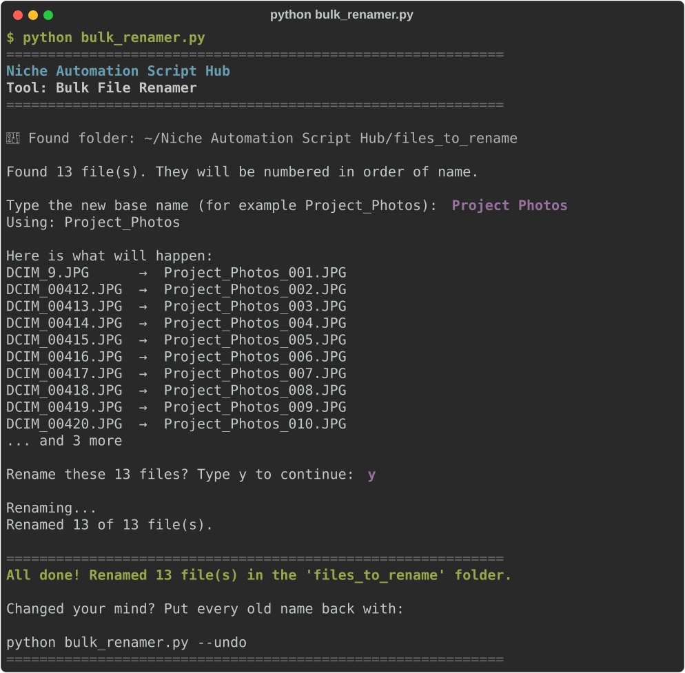

<p align="center">
  
</p>

<p align="center">
  <a href="https://github.com/kapoorraghav-cmd/niche-automation-script-hub/actions/workflows/tests.yml"></a>
  <a href="https://www.python.org/downloads/"></a>
  
  <a href="LICENSE"></a>
</p>

**Simple Python scripts that automate tedious office tasks — written for people who don't write code.**

No dashboards. No accounts. No uploads. Each tool is one script: drop your files in a folder, run one command, and collect the results.

---

## Table of contents

1. [Why this hub exists](#1-why-this-hub-exists)
2. [The tools](#2-the-tools)
3. [See it in action](#3-see-it-in-action)
4. [Quick start](#4-quick-start)
5. [Complete beginner setup](#5-complete-beginner-setup)
6. [Using any tool](#6-using-any-tool)
7. [Project folder layout](#7-project-folder-layout)
8. [Safe tips for non-developers](#8-safe-tips-for-non-developers)
9. [Troubleshooting](#9-troubleshooting)
10. [Contributing](#10-contributing)
11. [License](#11-license)

---

## 1. Why this hub exists

Office work is full of repetitive chores: shrinking photo attachments, cleaning messy spreadsheets, copying text out of PDFs, typing up meeting notes, renaming hundreds of files. This repository collects **small, separate scripts** so you can:

- Use only the tool you need
- Read the code — it is heavily commented on purpose
- Trust your files: originals are never overwritten, and nothing is uploaded anywhere (the web scraper only downloads the pages you ask for)

If you have never used Python before, start at [Complete beginner setup](#5-complete-beginner-setup).

---

## 2. The tools

| Tool | Run this | What it does | Guide |
|------|----------|--------------|-------|
| 🖼️ **Image Compressor & Converter** | `python image_compressor.py` | Shrinks JPG/PNG photos to modern `.webp` files under ~200 KB that still look great | [Guide](docs/tools/image-compressor.md) |
| 📊 **Spreadsheet Cleaner** | `python excel_cleaner.py` | Removes duplicate rows and standardizes dates to `YYYY-MM-DD` in Excel and CSV files | [Guide](docs/tools/spreadsheet-cleaner.md) |
| 📄 **PDF Text & Image Extractor** | `python pdf_extractor.py` | Pulls all the text out of PDFs into `.txt` files and saves every picture inside them | [Guide](docs/tools/pdf-extractor.md) |
| 🎙️ **Audio-to-Text Transcriber** | `python audio_transcriber.py` | Turns meeting recordings and voice memos into written transcripts, privately on your computer | [Guide](docs/tools/audio-transcriber.md) |
| 🏷️ **Bulk File Renamer** | `python bulk_renamer.py` | Renames hundreds of files like `DCIM_00412.jpg` to `Project_Photos_001.jpg`, with preview and undo | [Guide](docs/tools/bulk-renamer.md) |
| 🌐 **Website-to-Markdown Scraper** | `python web_scraper.py` | Saves web articles as clean Markdown files, without the ads, menus, and pop-ups | [Guide](docs/tools/web-scraper.md) |

---

## 3. See it in action

**Image Compressor** — a 938 KB photo becomes a 192 KB WebP that looks the same:


**Spreadsheet Cleaner** — duplicate rows removed, four different date styles standardized:



**Bulk File Renamer** — preview, confirm, done (and `--undo` if you change your mind):



More screenshots are in each tool's guide.

---

## 4. Quick start

Already comfortable with Python? From the project folder:

```bash
python -m venv .venv
source .venv/bin/activate          # Windows: .venv\Scripts\activate
pip install -r requirements.txt
```

Then put your files in the tool's folder and run it, for example:

```bash
python image_compressor.py         # photos go in input_images/
```

New to all of this? The next section walks through every click.

---

## 5. Complete beginner setup

Follow the section for **your** computer. Take your time — each step is written for someone who has never used Python. You only do this once.

### Step A — Install Python

#### On Windows

1. Open your web browser and go to: [https://www.python.org/downloads/](https://www.python.org/downloads/)
2. Click the big yellow **Download Python** button.
3. Run the installer you just downloaded.
4. **IMPORTANT:** On the first screen, check the box that says **"Add python.exe to PATH"** (near the bottom).
5. Click **Install Now** and wait until it finishes.
6. Close the installer.

#### On Mac

**Option 1 (easiest for many people):**

1. Go to [https://www.python.org/downloads/](https://www.python.org/downloads/)
2. Download the latest macOS installer.
3. Open the `.pkg` file and click through **Continue / Install**.
4. When it finishes, you’re done with this step.

**Option 2 (if you already use Homebrew):**

```bash
brew install python
```

#### On Linux (Ubuntu / Debian-style)

```bash
sudo apt update
sudo apt install python3 python3-pip python3-venv
```

### Step B — Confirm Python works

1. Open a terminal:
   - **Windows:** Press the Windows key, type `cmd` or `PowerShell`, and press Enter.
   - **Mac:** Press `Command + Space`, type `Terminal`, press Enter.
   - **Linux:** Open your Terminal app.
2. Type this and press Enter:

```bash
python --version
```

If that fails on Mac/Linux, try:

```bash
python3 --version
```

You should see something like `Python 3.12.x` (any 3.10+ is fine).

> **Note:** If `python` does not work but `python3` does, use `python3` and `pip3` everywhere below instead of `python` and `pip`.

### Step C — Get this project onto your computer

**Easiest:** on this page, click the green **Code** button → **Download ZIP**. Unzip it and put the folder somewhere easy to find (for example your Desktop).

**If you use Git:**

```bash
git clone https://github.com/kapoorraghav-cmd/niche-automation-script-hub.git
cd niche-automation-script-hub
```

### Step D — Open the terminal inside the project folder

#### Windows (Command Prompt)

```bash
cd Desktop\niche-automation-script-hub-main
```

#### Mac / Linux

```bash
cd ~/Desktop/niche-automation-script-hub-main
```

(Use your folder's real name. Tip: type `cd ` with a space, then drag the folder onto the terminal window and press Enter.)

Check you’re in the right place (`ls` on Mac/Linux, `dir` on Windows). You should see files like `image_compressor.py`, `requirements.txt`, and `README.md`.

### Step E — Create a virtual environment (recommended)

A virtual environment is a **private toolbox** for this project, so its libraries don't mix with anything else on your computer.

```bash
python -m venv .venv
```

Activate it:

| System | Command |
|--------|---------|
| Windows Command Prompt | `.venv\Scripts\activate` |
| Windows PowerShell | `.venv\Scripts\Activate.ps1` |
| Mac / Linux | `source .venv/bin/activate` |

If PowerShell blocks activation:

```bash
Set-ExecutionPolicy -Scope CurrentUser RemoteSigned
```

You should see `(.venv)` at the start of your terminal line when it worked. **Activate it again each time you open a new terminal.**

### Step F — Install the required libraries

```bash
pip install -r requirements.txt
```

Fallbacks if needed:

```bash
python -m pip install -r requirements.txt
# or
pip3 install -r requirements.txt
```

This installs everything all six tools need (a few hundred MB). Only want one tool? Install just its libraries instead:

| Tool | Command |
|------|---------|
| Image Compressor | `pip install Pillow` |
| Spreadsheet Cleaner | `pip install pandas openpyxl xlrd` |
| PDF Extractor | `pip install pypdf Pillow` |
| Audio Transcriber | `pip install faster-whisper` |
| Bulk File Renamer | *nothing — it's built into Python* |
| Web Scraper | `pip install trafilatura` |

---

## 6. Using any tool

Every tool works the same way:

1. **Run it once** — it creates its input folder and tells you what to put there.
2. **Drop your files in** that folder.
3. **Run it again** and watch the friendly progress messages.
4. **Collect the results** from its output folder.

| Tool | Put files in | Results appear in |
|------|-------------|-------------------|
| Image Compressor | `input_images/` | `optimized_images/` |
| Spreadsheet Cleaner | `input_spreadsheets/` | `cleaned_spreadsheets/` |
| PDF Extractor | `input_pdfs/` | `extracted_pdfs/` |
| Audio Transcriber | `input_audio/` | `transcripts/` |
| Bulk File Renamer | `files_to_rename/` | *renamed in place, with undo* |
| Web Scraper | links in `urls.txt` (or typed in) | `scraped_articles/` |

Each [tool guide](#2-the-tools) explains its options, what it changes, and what it leaves alone.

---

## 7. Project folder layout

```text
niche-automation-script-hub/
├── README.md                  ← you are here
├── image_compressor.py        ← the six tools
├── excel_cleaner.py
├── pdf_extractor.py
├── audio_transcriber.py
├── bulk_renamer.py
├── web_scraper.py
├── requirements.txt           ← libraries the tools need
├── requirements-dev.txt       ← extra libraries for tests and screenshots
├── docs/
│   ├── tools/                 ← one guide per tool
│   ├── screenshots/           ← real terminal output, rebuilt by make_screenshots.py
│   └── assets/                ← banner and before/after pictures
├── tests/                     ← automated checks for every tool
├── input_images/, input_pdfs/, …   ← where you drop your files
└── optimized_images/, transcripts/, …   ← where results appear
```

The empty input/output folders are kept in Git with tiny `.gitkeep` files. Your own photos, spreadsheets, recordings, and reading lists stay on your computer only (see `.gitignore`).

---

## 8. Safe tips for non-developers

- **Originals stay untouched.** Every tool writes to its own output folder — except the Bulk File Renamer, which previews every change, asks first, and can undo.
- **Your files stay private.** Nothing you process is uploaded. Even the transcriber runs on your own computer.
- **Keep a backup** of important files before batch-processing anything.
- **Close files** in Excel, Photos, or your PDF reader before processing them.
- **Stop anytime** with `Ctrl + C` in the terminal.
- **Don’t paste random commands** from strangers. Only use commands from this README (or people you trust).
- **Stay in the project folder** (and keep `.venv` activated) before running `pip install` or a tool.

---

## 9. Troubleshooting

| Problem | What to try |
|---------|-------------|
| `'python' is not recognized` | Reinstall Python and check **Add to PATH**. Or try `python3`. Open a **new** terminal after installing. |
| `No module named ...` | You haven't installed the libraries yet, or `.venv` isn't activated. Activate it (Step E), then `pip install -r requirements.txt` |
| `No such file or directory: 'image_compressor.py'` | Your terminal isn't in the project folder. Go back to Step D |
| A tool says it found no files | Put the files **directly** into its input folder, not in a subfolder |
| PowerShell won’t activate `.venv` | `Set-ExecutionPolicy -Scope CurrentUser RemoteSigned`, then activate again |
| Permission / “access denied” | Close the file in the program that has it open, then try again |

Tool-specific problems are covered at the bottom of each [tool guide](#2-the-tools). Still stuck? [Open an issue](https://github.com/kapoorraghav-cmd/niche-automation-script-hub/issues/new/choose) and paste what the terminal printed.

---

## 10. Contributing

Ideas and improvements are welcome — especially from people who don't code:

- 💡 [Suggest a new tool](https://github.com/kapoorraghav-cmd/niche-automation-script-hub/issues/new?template=new_tool_idea.yml) — just describe the boring task.
- 🐞 [Report a problem](https://github.com/kapoorraghav-cmd/niche-automation-script-hub/issues/new?template=bug_report.yml)
- 🛠️ Build a tool — see [CONTRIBUTING.md](CONTRIBUTING.md) for the checklist every tool follows.

### Running the tests

The tests create sample photos, spreadsheets, PDFs, recordings, and web pages in a temporary folder, run each tool on them, and check the results. They never touch your own files.

```bash
pip install -r requirements-dev.txt
python -m pytest
```

You should see a line like `130 passed`. The same tests run automatically on GitHub (Windows, Mac, and Linux) every time a change is pushed — that's what the green **Tests** badge at the top of this page shows.

To rebuild the screenshots after changing a tool's messages: `python docs/make_screenshots.py`

---

## 11. License

Released under the [MIT License](LICENSE). You are free to use, copy, modify, and share these scripts, including for commercial work, as long as the license notice stays with them.
