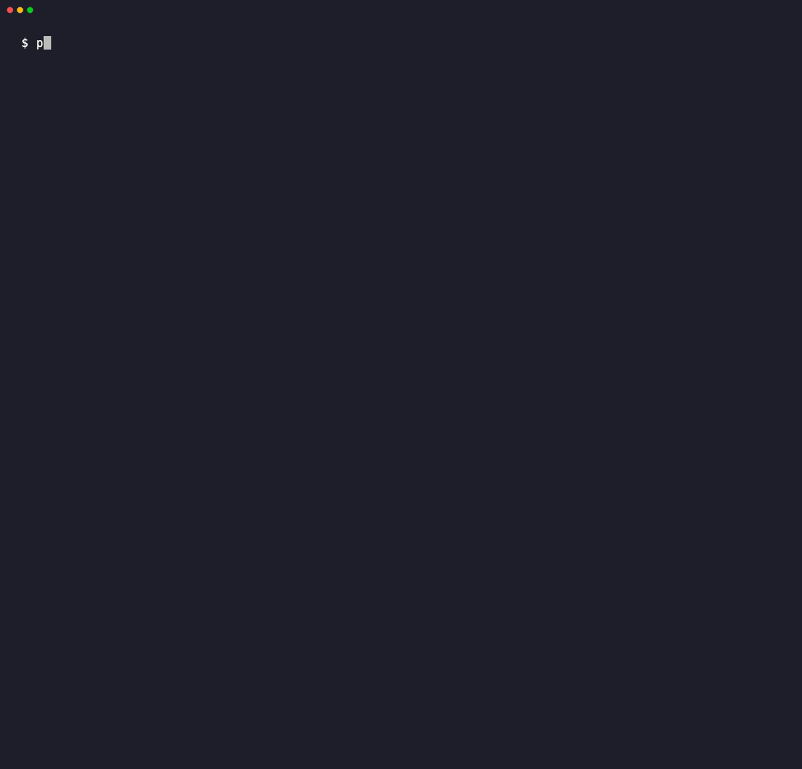
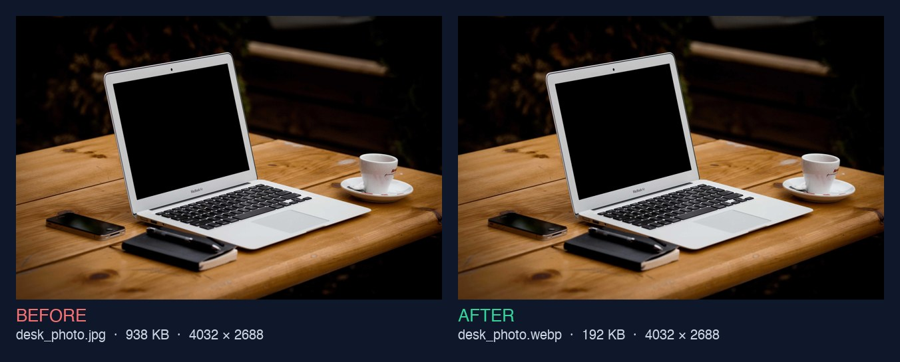
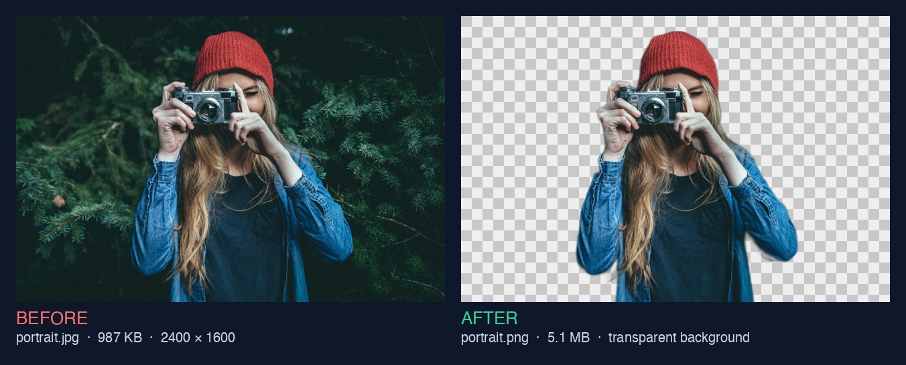
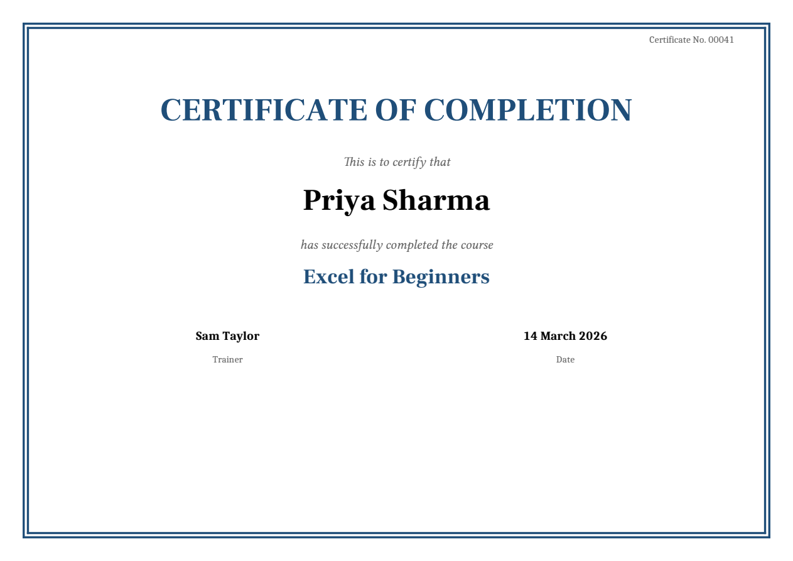

<p align="center">
  
</p>

<p align="center">
  <a href="https://github.com/kapoorraghav-cmd/niche-automation-script-hub/releases/latest"></a>
  <a href="https://github.com/kapoorraghav-cmd/niche-automation-script-hub/actions/workflows/tests.yml"></a>
  <a href="https://www.python.org/downloads/"></a>
  
  <a href="LICENSE"></a>
</p>

<h3 align="center">13 free tools that automate boring office work — and never upload your files.</h3>

<p align="center">
  <a href="https://github.com/kapoorraghav-cmd/niche-automation-script-hub/releases/latest"><b>⬇️ Download</b></a> ·
  <a href="#4-start-here-no-terminal-needed"><b>▶️ Start here</b></a> ·
  <a href="#2-the-tools"><b>🧰 See all tools</b></a> ·
  <a href="#7-faq"><b>❓ FAQ</b></a>
</p>

Compress photos, remove backgrounds, read scanned documents, mail-merge certificates, clean and merge spreadsheets, transcribe meetings, make subtitles, summarize meetings, find duplicate files, and more. **Double-click to start, pick a tool from the menu, done** — no coding, no accounts, no subscriptions.

<p align="center">
  
</p>

---

## Table of contents

1. [Why not just use a website?](#1-why-not-just-use-a-website)
2. [The tools](#2-the-tools)
3. [See it in action](#3-see-it-in-action)
4. [Start here (no terminal needed)](#4-start-here-no-terminal-needed)
5. [Complete beginner setup (terminal)](#5-complete-beginner-setup-terminal)
6. [Using any tool](#6-using-any-tool)
7. [FAQ](#7-faq)
8. [Project folder layout](#8-project-folder-layout)
9. [Safe tips for non-developers](#9-safe-tips-for-non-developers)
10. [Troubleshooting](#10-troubleshooting)
11. [Contributing](#11-contributing)
12. [License](#12-license)

---

## 1. Why not just use a website?

There are websites for most of these jobs. Here's why this hub is different:

| | Typical "free" online tool | Niche Automation Script Hub |
|---|---|---|
| 🔒 **Your files** | Uploaded to someone else's server | Stay on your computer |
| 💷 **Cost** | Free trial, then a subscription | Free forever (MIT license) |
| 📦 **Limits** | File-size caps, a few files per day | No limits — whole folders at once |
| 📴 **Offline** | Needs internet for everything | Works offline after a one-time setup* |
| 🙈 **Ads & sign-ups** | Usually | Never |
| 🔍 **Transparency** | Closed | Every line of code is readable and commented |

\* *The web scraper needs internet to fetch the pages you ask for, and the AI tools download their models once.*

This matters most for the files offices actually handle: contracts, payroll spreadsheets, customer lists, meeting recordings, ID photos.

---

## 2. The tools

**Pictures**

| Tool | What it does | Guide |
|------|--------------|-------|
| 🖼️ **Image Compressor & Converter** | Shrinks JPG/PNG photos to modern `.webp` files under ~200 KB that still look great | [Guide](docs/tools/image-compressor.md) |
| ✂️ **Background Remover** | Cuts the background out of product photos, headshots and ID photos — transparent or white | [Guide](docs/tools/background-remover.md) |

**Documents**

| Tool | What it does | Guide |
|------|--------------|-------|
| 📄 **PDF Text & Image Extractor** | Pulls all the text out of PDFs into `.txt` files and saves every picture inside them | [Guide](docs/tools/pdf-extractor.md) |
| 🔎 **Scanned Document Reader (OCR)** | Reads the words in scanned PDFs, photos of receipts and letters, and screenshots | [Guide](docs/tools/ocr-reader.md) |
| ✉️ **Mail-Merge Certificates & Letters** | A Word template + a spreadsheet → one personalised Word/PDF document per person | [Guide](docs/tools/mail-merge.md) |

**Spreadsheets**

| Tool | What it does | Guide |
|------|--------------|-------|
| 📊 **Spreadsheet Cleaner** | Removes duplicate rows and standardizes messy dates to `YYYY-MM-DD` | [Guide](docs/tools/spreadsheet-cleaner.md) |
| 🧩 **Spreadsheet Merger** | Combines dozens of Excel/CSV files into one, even when column names differ slightly | [Guide](docs/tools/spreadsheet-merger.md) |

**Audio, video & meetings**

| Tool | What it does | Guide |
|------|--------------|-------|
| 🎙️ **Audio-to-Text Transcriber** | Turns meeting recordings and voice memos into written transcripts | [Guide](docs/tools/audio-transcriber.md) |
| 🎬 **Video Subtitle Maker** | Creates `.srt` and `.vtt` subtitle files for your videos | [Guide](docs/tools/video-subtitles.md) |
| 📝 **Meeting Notes Summarizer** | Turns transcripts into a summary, decisions and an action-item table — using local AI | [Guide](docs/tools/meeting-summarizer.md) |

**Files & web**

| Tool | What it does | Guide |
|------|--------------|-------|
| 🏷️ **Bulk File Renamer** | Renames hundreds of files like `DCIM_00412.jpg` to `Project_Photos_001.jpg`, with preview and undo | [Guide](docs/tools/bulk-renamer.md) |
| 🗂️ **Duplicate File Finder** | Finds duplicate files and similar photos, and moves the extra copies aside (never deletes) | [Guide](docs/tools/duplicate-finder.md) |
| 🌐 **Website-to-Markdown Scraper** | Saves web articles as clean Markdown files, without the ads, menus and pop-ups | [Guide](docs/tools/web-scraper.md) |

The AI-powered tools (speech, background removal, text reading, meeting notes) run **locally** — the models run on your own computer, not in the cloud.

---

## 3. See it in action

**Image Compressor** — a 938 KB photo becomes a 192 KB WebP that looks the same:



**Background Remover** — one click, transparent background:



**Mail-Merge** — one spreadsheet row, one finished certificate:

<p align="center"></p>

**Spreadsheet Cleaner** — duplicate rows removed, four different date styles standardized:


**Bulk File Renamer** — preview, confirm, done (and `--undo` if you change your mind):


Every tool's guide has more screenshots, all made from real runs.

---

## 4. Start here (no terminal needed)

**You don't need to install Python** — the launcher sets everything up by itself.

1. **Download the hub** — click [⬇️ Download](https://github.com/kapoorraghav-cmd/niche-automation-script-hub/releases/latest), then the `.zip` file under *Assets*. Unzip it somewhere easy, like your Desktop.
2. **Double-click the launcher** inside the folder:

   | Your computer | Double-click |
   |---|---|
   | Windows | `Start (Windows).bat` |
   | Mac | `Start (Mac).command` |
   | Linux | `start.sh` (or run `./start.sh`) |

   The **first time**, it needs internet for about a minute: it downloads [uv](https://docs.astral.sh/uv/) (a free, widely used Python installer) and a private copy of Python, about 40 MB in total. Everything is kept **inside the hub's folder** — nothing else on your computer changes, and deleting the folder removes it all.
3. **Pick a tool** from the menu. It installs what that tool needs (first time only), opens the folder for your files, runs the tool, and offers to open the results.

If the automatic setup can't download (for example, a strict work network), the launcher uses Python from [python.org](https://www.python.org/downloads/) instead, if it's installed — see [Step A](#step-a--install-python).

> **"Windows protected your PC"?** Click **More info → Run anyway**. Windows sometimes shows this for scripts downloaded from the internet.
>
> **Mac says it "can't be opened"?** Right-click the file → **Open** → **Open**. On newer macOS versions, go to **System Settings → Privacy & Security** and click **Open Anyway**. You only need to do this once.

---

## 5. Complete beginner setup (terminal)

Prefer typing commands, or the launcher couldn't set itself up (for example, on a work network that blocks downloads)? Follow the section for **your** computer. Take your time — each step is written for someone who has never used Python. You only do this once.

### Step A — Install Python

#### On Windows

1. Open your web browser and go to: [https://www.python.org/downloads/](https://www.python.org/downloads/)
2. Click the big yellow **Download Python** button.
3. Run the installer you just downloaded.
4. **IMPORTANT:** On the first screen, check the box that says **"Add python.exe to PATH"** (near the bottom).
5. Click **Install Now** and wait until it finishes.
6. Close the installer.

#### On Mac

**Option 1 (easiest for many people):**

1. Go to [https://www.python.org/downloads/](https://www.python.org/downloads/)
2. Download the latest macOS installer.
3. Open the `.pkg` file and click through **Continue / Install**.
4. When it finishes, you’re done with this step.

**Option 2 (if you already use Homebrew):**

```bash
brew install python
```

#### On Linux (Ubuntu / Debian-style)

```bash
sudo apt update
sudo apt install python3 python3-pip python3-venv
```

### Step B — Confirm Python works

1. Open a terminal:
   - **Windows:** Press the Windows key, type `cmd` or `PowerShell`, and press Enter.
   - **Mac:** Press `Command + Space`, type `Terminal`, press Enter.
   - **Linux:** Open your Terminal app.
2. Type this and press Enter:

```bash
python --version
```

If that fails on Mac/Linux, try:

```bash
python3 --version
```

You should see something like `Python 3.12.x` (any 3.10+ is fine).

> **Note:** If `python` does not work but `python3` does, use `python3` and `pip3` everywhere below instead of `python` and `pip`.

### Step C — Get this project onto your computer

**Easiest:** download the `.zip` from the [latest release](https://github.com/kapoorraghav-cmd/niche-automation-script-hub/releases/latest), unzip it, and put the folder somewhere easy to find (for example your Desktop).

**If you use Git:**

```bash
git clone https://github.com/kapoorraghav-cmd/niche-automation-script-hub.git
cd niche-automation-script-hub
```

### Step D — Open the terminal inside the project folder

#### Windows (Command Prompt)

```bash
cd Desktop\niche-automation-script-hub
```

#### Mac / Linux

```bash
cd ~/Desktop/niche-automation-script-hub
```

(Use your folder's real name. Tip: type `cd ` with a space, then drag the folder onto the terminal window and press Enter.)

Check you’re in the right place (`ls` on Mac/Linux, `dir` on Windows). You should see files like `start.py`, `requirements.txt`, and `README.md`.

### Step E — Create a virtual environment (recommended)

A virtual environment is a **private toolbox** for this project, so its libraries don't mix with anything else on your computer.

```bash
python -m venv .venv
```

Activate it:

| System | Command |
|--------|---------|
| Windows Command Prompt | `.venv\Scripts\activate` |
| Windows PowerShell | `.venv\Scripts\Activate.ps1` |
| Mac / Linux | `source .venv/bin/activate` |

If PowerShell blocks activation:

```bash
Set-ExecutionPolicy -Scope CurrentUser RemoteSigned
```

You should see `(.venv)` at the start of your terminal line when it worked. **Activate it again each time you open a new terminal.**

### Step F — Install the libraries, then start

The simplest option is to start the menu, which installs each tool's libraries the first time you use it:

```bash
python start.py
```

Or install everything at once (about 1–2 GB, as the AI tools use large libraries):

```bash
pip install -r requirements.txt
```

Or just one tool's libraries:

| Tool | Command |
|------|---------|
| Image Compressor | `pip install Pillow` |
| Background Remover | `pip install onnxruntime numpy Pillow` |
| PDF Extractor | `pip install pypdf Pillow` |
| Scanned Document Reader | `pip install rapidocr onnxruntime pypdfium2 pypdf Pillow` |
| Mail-Merge | `pip install docxtpl pandas openpyxl xlrd` |
| Spreadsheet Cleaner / Merger | `pip install pandas openpyxl xlrd` |
| Audio Transcriber / Video Subtitles | `pip install faster-whisper "av<16"` |
| Meeting Notes Summarizer | *nothing from pip* — install the free [Ollama](https://ollama.com) app |
| Bulk File Renamer | *nothing — built into Python* |
| Duplicate File Finder | `pip install Pillow` (optional, for similar photos) |
| Web Scraper | `pip install trafilatura` |

---

## 6. Using any tool

Every tool works the same way — whether you use the menu or type `python <tool>.py`:

1. **Run it once** — it creates its input folder and tells you what to put there.
2. **Drop your files in** that folder.
3. **Run it again** and watch the friendly progress messages.
4. **Collect the results** from its output folder.

| Tool | Run | Put files in | Results appear in |
|------|-----|-------------|-------------------|
| Image Compressor | `python image_compressor.py` | `input_images/` | `optimized_images/` |
| Background Remover | `python background_remover.py` | `input_photos/` | `no_background/` |
| PDF Extractor | `python pdf_extractor.py` | `input_pdfs/` | `extracted_pdfs/` |
| Scanned Document Reader | `python ocr_reader.py` | `input_scans/` | `scanned_text/` |
| Mail-Merge | `python mail_merge.py` | `mail_merge/` (template + spreadsheet) | `merged_documents/` |
| Spreadsheet Cleaner | `python excel_cleaner.py` | `input_spreadsheets/` | `cleaned_spreadsheets/` |
| Spreadsheet Merger | `python spreadsheet_merger.py` | `spreadsheets_to_merge/` | `merged_spreadsheets/` |
| Audio Transcriber | `python audio_transcriber.py` | `input_audio/` | `transcripts/` |
| Video Subtitle Maker | `python video_subtitles.py` | `input_videos/` | `subtitles/` |
| Meeting Notes Summarizer | `python meeting_summarizer.py` | `transcripts/` | `meeting_notes/` |
| Bulk File Renamer | `python bulk_renamer.py` | `files_to_rename/` | *renamed in place, with undo* |
| Duplicate File Finder | `python duplicate_finder.py` | `files_to_check/` (or any folder) | `duplicates_review/` |
| Web Scraper | `python web_scraper.py` | links in `urls.txt` (or typed in) | `scraped_articles/` |

Each [tool guide](#2-the-tools) explains its options, what it changes, and what it leaves alone.

---

## 7. FAQ

<details>
<summary><b>Do I need to know how to code?</b></summary>

No. Double-click the launcher and pick tools from a numbered menu. The code is there if you're curious — every script is heavily commented in plain English — but you never have to touch it.
</details>

<details>
<summary><b>Do I need to install Python?</b></summary>

No. The first time you double-click the launcher, it downloads [uv](https://docs.astral.sh/uv/) and a private copy of Python (about 40 MB) into a hidden `.uv` folder inside the hub. It doesn't touch any other Python on your computer, and deleting the hub's folder removes everything. If you move the folder, the launcher notices and quickly sets itself up again.
</details>

<details>
<summary><b>Is it really free?</b></summary>

Yes. The hub is open source under the MIT license, and every library and model it uses is free. The Meeting Notes Summarizer uses [Ollama](https://ollama.com), which is also free. There are no trials, accounts, or usage limits.
</details>

<details>
<summary><b>Are my files uploaded anywhere?</b></summary>

No. Every tool processes files on your own computer. The only internet use is: a one-time model download for the speech, background-removal and text-reading tools; the web scraper fetching the pages you ask for; and the summarizer talking to the Ollama app *on your own computer*. See [SECURITY.md](SECURITY.md) for details.
</details>

<details>
<summary><b>Will it change or delete my original files?</b></summary>

No tool ever deletes anything. Most tools only read your files and write results to a separate folder. The two that move or rename files (Bulk File Renamer and Duplicate File Finder) show a preview, ask before doing anything, and can undo with `--undo`.
</details>

<details>
<summary><b>Will it work on my work laptop?</b></summary>

Usually — nothing needs administrator rights, because everything installs inside the hub's folder. Some company networks block downloads from GitHub or Hugging Face. If the first-time setup or a tool's model download is blocked, you'll get a clear message; ask IT or run it once on another network. After that, the tools work offline.
</details>

<details>
<summary><b>What kind of computer do I need?</b></summary>

Windows 10/11, macOS, or Linux. The launcher brings its own Python; if you use the terminal instead, you need Python 3.10 or newer. The simple tools run on anything. For the AI tools, 8 GB of memory is recommended, plus about 2–3 GB of free disk space for the models (the meeting summarizer's model alone is about 2 GB).
</details>

<details>
<summary><b>How accurate are the AI tools?</b></summary>

Very good for clear audio, clean scans and photos with one obvious subject — but not perfect. Always proofread names, numbers and action items before sharing. Each guide explains how to get better results (for example, choosing a larger speech model).
</details>

<details>
<summary><b>Can I use it for my business?</b></summary>

Yes. The MIT license allows personal and commercial use. Please respect websites' terms when using the web scraper.
</details>

<details>
<summary><b>How do I update to a new version?</b></summary>

Download the latest release and unzip it. Your own files live in the tools' folders (like `input_images/`), so copy any you still need into the new folder. If you used Git: `git pull`.
</details>

<details>
<summary><b>Something went wrong. What now?</b></summary>

Check [Troubleshooting](#10-troubleshooting) and the bottom of the tool's guide. Still stuck? [Open an issue](https://github.com/kapoorraghav-cmd/niche-automation-script-hub/issues/new/choose) and paste what the terminal printed — no question is too basic.
</details>

---

## 8. Project folder layout

```text
niche-automation-script-hub/
├── Start (Windows).bat          ← double-click to start (Windows)
├── Start (Mac).command          ← double-click to start (Mac)
├── start.sh                     ← run to start (Linux)
├── start.py                     ← the "Start here" menu
├── image_compressor.py, …       ← the 13 tools, one script each
├── requirements.txt             ← libraries the tools need
├── requirements-dev.txt         ← extra libraries for tests and screenshots
├── docs/
│   ├── tools/                   ← one guide per tool
│   ├── screenshots/, gifs/      ← real terminal output, rebuilt by scripts
│   └── assets/                  ← banner and before/after pictures
├── tests/                       ← automated checks for every tool
├── input_images/, input_pdfs/, …       ← where you drop your files
└── optimized_images/, transcripts/, …  ← where results appear
```

The empty input/output folders are kept in Git with tiny `.gitkeep` files. Your own photos, spreadsheets, recordings, and reading lists stay on your computer only (see `.gitignore`).

---

## 9. Safe tips for non-developers

- **Originals stay untouched.** Every tool writes to its own output folder — except the Bulk File Renamer and Duplicate File Finder, which preview every change, ask first, never delete, and can undo.
- **Your files stay private.** Nothing you process is uploaded.
- **Keep a backup** of important files before batch-processing anything.
- **Close files** in Excel, Photos, or your PDF reader before processing them.
- **Proofread AI output** (transcripts, scanned text, meeting notes) before sharing it.
- **Stop anytime** with `Ctrl + C` in the terminal.
- **Don’t paste random commands** from strangers. Only use commands from this README (or people you trust).

---

## 10. Troubleshooting

| Problem | What to try |
|---------|-------------|
| Launcher says "the automatic setup did not work" | Check your internet connection. On a work network that blocks downloads, install Python from python.org ([Step A](#step-a--install-python)) and double-click again |
| Launcher window flashes and closes | Right-click the launcher → **Open** (Mac), or run it from a terminal to see the message, and [open an issue](https://github.com/kapoorraghav-cmd/niche-automation-script-hub/issues/new/choose) with what it says |
| "Windows protected your PC" | Click **More info → Run anyway** |
| Mac: "can't be opened because it is from an unidentified developer" | Right-click → **Open** → **Open**, or **System Settings → Privacy & Security → Open Anyway** |
| `'python' is not recognized` | Reinstall Python and check **Add to PATH**. Or try `python3`. Open a **new** terminal after installing |
| `No module named ...` | Use the menu (it installs what's needed), or activate `.venv` (Step E) and run `pip install -r requirements.txt` |
| `No such file or directory: 'image_compressor.py'` | Your terminal isn't in the project folder. Go back to Step D |
| A tool says it found no files | Put the files **directly** into its input folder, not in a subfolder |
| A model download fails | Check your internet connection; work networks sometimes block it — try another network once |
| PowerShell won’t activate `.venv` | `Set-ExecutionPolicy -Scope CurrentUser RemoteSigned`, then activate again |
| Permission / “access denied” | Close the file in the program that has it open, then try again |

Tool-specific problems are covered at the bottom of each [tool guide](#2-the-tools). Still stuck? [Open an issue](https://github.com/kapoorraghav-cmd/niche-automation-script-hub/issues/new/choose) or ask in [Discussions](https://github.com/kapoorraghav-cmd/niche-automation-script-hub/discussions).

---

## 11. Contributing

Ideas and improvements are welcome — especially from people who don't code:

- 💡 [Suggest a new tool](https://github.com/kapoorraghav-cmd/niche-automation-script-hub/issues/new?template=new_tool_idea.yml) — just describe the boring task.
- 🐞 [Report a problem](https://github.com/kapoorraghav-cmd/niche-automation-script-hub/issues/new?template=bug_report.yml)
- 💬 [Ask a question or share how you use it](https://github.com/kapoorraghav-cmd/niche-automation-script-hub/discussions)
- 🛠️ Build a tool — see [CONTRIBUTING.md](CONTRIBUTING.md) for the checklist every tool follows. Please read our [Code of Conduct](CODE_OF_CONDUCT.md).

### Running the tests

The tests create sample photos, spreadsheets, PDFs, recordings, videos and web pages in a temporary folder, run each tool on them, and check the results. They never touch your own files.

```bash
pip install -r requirements-dev.txt
python -m pytest
```

You should see a line like `351 passed`. The same tests run automatically on GitHub (Windows, Mac, and Linux) every time a change is pushed — that's what the green **Tests** badge at the top of this page shows. Dependabot checks weekly for library updates, and the tests confirm each one is safe before it's merged.

To rebuild the screenshots and demo GIFs after changing a tool's messages: `python docs/make_screenshots.py` and `python docs/make_gifs.py`.

---

## 12. License

Released under the [MIT License](LICENSE). You are free to use, copy, modify, and share these scripts, including for commercial work, as long as the license notice stays with them.
