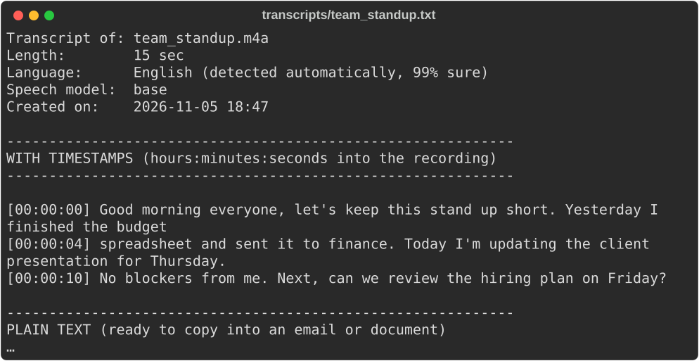
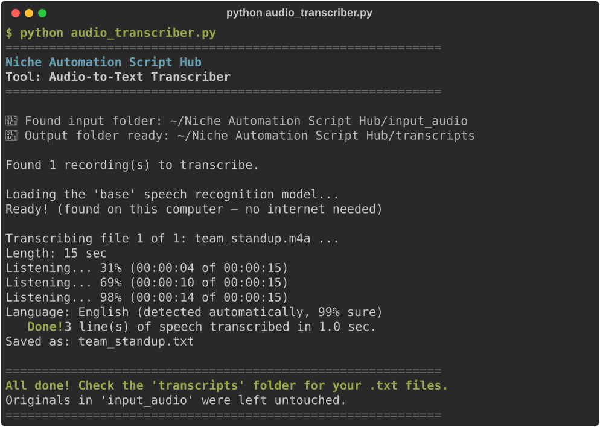

# Audio-to-Text Transcriber

**Script:** [`audio_transcriber.py`](../../audio_transcriber.py) · **Input:** `input_audio/` · **Output:** `transcripts/`

Turns meeting recordings and voice memos into written transcripts — with timestamps, plus a plain-text version ready to paste into an email.

**Private by design:** the speech recognition runs entirely on your own computer. Your recordings are never uploaded anywhere.



---

## How to use it

### 1. Put your recordings in the input folder

Create (or let the script create) a folder named exactly `input_audio` next to the script, and copy your recordings **directly** into it.

Supported: `.mp3`, `.m4a` (iPhone voice memos), `.wav`, `.ogg`, `.flac`, `.aac`, `.wma`, and video files (`.mp4`, `.mov`, `.webm` — only the sound is used). You do **not** need to install ffmpeg or any other audio software.

### 2. Run the script

```bash
python audio_transcriber.py
```

### 3. Watch the progress



The **first time** you run it, it downloads the speech model (about 145 MB) — this needs internet and can take a few minutes. After that it works offline.

### 4. Get your transcripts

Open `transcripts/`. Each recording gets a `.txt` file with the same name (`team_standup.m4a` → `team_standup.txt`) containing:

1. A short header: file name, length, detected language.
2. **With timestamps** — every line starts with `[hours:minutes:seconds]` so you can find that moment in the recording.
3. **Plain text** — the same words as tidy paragraphs, ready to copy into an email or document.

**Your recordings in `input_audio/` are never changed.**

---

## Good to know

- **Speed:** with the default model, a 10-minute recording usually takes 30 seconds to 2 minutes on a normal laptop. Progress is printed as it goes, so long recordings never look frozen.
- **Accuracy:** clear audio with one person speaking at a time works best. Background music, crosstalk, and very quiet speakers reduce accuracy. Always proofread names and numbers.
- **Speakers aren't labelled** — the transcript doesn't say *who* said each line.
- **Language** is detected automatically. If it guesses wrong (common with very short clips), open `audio_transcriber.py` and set `LANGUAGE = "en"` (or `"es"`, `"fr"`, `"de"`, …).
- **More accuracy, if you need it:** set `MODEL_SIZE` at the top of the script:

  | Model | One-time download | Best for |
  |---|---|---|
  | `"tiny"` | ~75 MB | Quick drafts of clear speech |
  | `"base"` (default) | ~145 MB | Everyday meetings and memos |
  | `"small"` | ~485 MB | Accents, background noise, names (about 3× slower) |
  | `"medium"` | ~1.5 GB | Best accuracy; needs a fast computer |

- Silent recordings are reported as "no speech was found" and skipped.

---

## Troubleshooting

| Problem | What to try |
|---------|-------------|
| `No module named 'faster_whisper'` | `pip install faster-whisper` or `pip install -r requirements.txt` |
| "The speech recognition model could not be downloaded" | The first run needs internet. Check your connection (or work/school firewall) and run again |
| A recording is skipped as unreadable | The file may be damaged or still downloading. Try playing it first, or re-export it as `.mp3` |
| The transcript is in the wrong language | Set `LANGUAGE = "en"` (or your language code) at the top of the script |

---

← [Back to all tools](../../README.md#2-the-tools)
