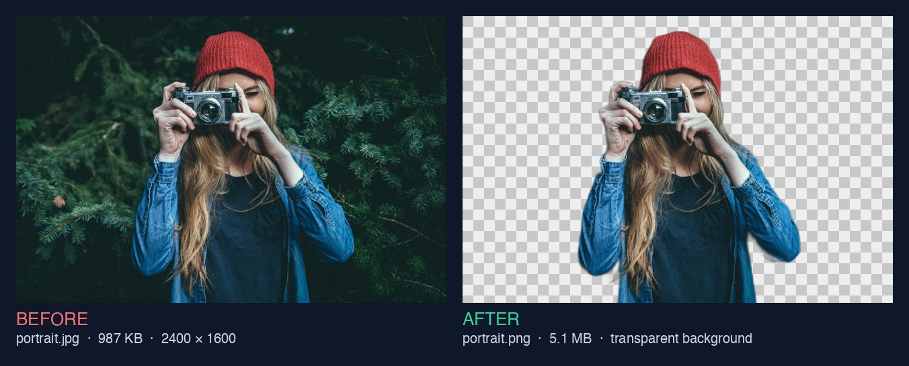
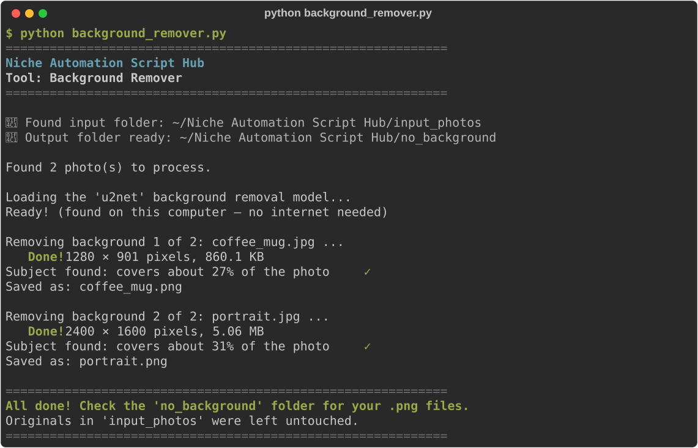

# Background Remover

**Script:** [`background_remover.py`](../../background_remover.py) · **Input:** `input_photos/` · **Output:** `no_background/`

Cuts the background out of product photos, headshots, and ID photos, and saves each one as a `.png` with a see-through (transparent) background, ready for online shops, slides, and flyers.

**Private by design:** a small AI model finds the subject on your own computer. Your photos are never uploaded anywhere.



---

## How to use it

### 1. Put your photos in the input folder

Create (or let the script create) a folder named exactly `input_photos` next to the script. Copy `.jpg`, `.jpeg`, `.png`, or `.webp` photos **directly** into it (no subfolders, no HEIC).

### 2. Run the script

```bash
python background_remover.py
```

### 3. Watch the progress



The **first time** you run it, it downloads the AI model (about 168 MB). This needs internet and can take a few minutes. After that it works offline. The download is checked to make sure it is complete and genuine before it is used.

### 4. Get your finished files

Open `no_background/`. Every photo gets a `.png` file with the same name (`coffee_mug.jpg` → `coffee_mug.png`), at the **same size as the original**. The checkerboard you see in many image viewers means "see-through".

**Your originals in `input_photos/` are never changed.**

---

## Settings you can change

Open `background_remover.py` in any text editor and change these lines near the top:

| Setting | Default | What it does |
|---|---|---|
| `BACKGROUND_COLOR` | `None` | `None` = see-through background. `"white"` = plain white, handy for ID, passport, and visa photos (check your country's official rules for size and head position too). Any color name or web code such as `"#F0F0F0"` works. |
| `CROP_TO_SUBJECT` | `False` | `True` trims the empty space around the subject, keeping a thin margin, so a small product fills the picture. |
| `EDGE_SOFTNESS` | `0` | Try `1` or `2` if edges look jagged or "cut out with scissors". |
| `MODEL` | `"u2net"` | Which AI model finds the subject (see below). |

### Choosing a model

| Model | One-time download | Best for |
|---|---|---|
| `"u2net"` (default) | ~168 MB | Products, people, and pets: the best all-rounder in our tests |
| `"u2netp"` | ~4.4 MB | Very small and fast. Fine for one object on a plain background, but may miss parts of a person or object |
| `"u2net_human_seg"` | ~168 MB | People only: headshots and ID photos. Poor at products |
| `"isnet-general-use"` | ~170 MB | Sometimes keeps finer detail, but more often left faint streaks or see-through patches in our tests. About 3× slower |

Models are saved in a `.cache/niche-automation-script-hub/models` folder inside your home folder, so every copy of this project shares them. You can delete that folder at any time to free up space; the model is simply downloaded again next time.

**Licences:** all four models were published by their authors (Xuebin Qin and colleagues, [U-2-Net](https://github.com/xuebinqin/U-2-Net) and [IS-Net](https://github.com/xuebinqin/DIS)) under the Apache License 2.0, which allows personal and commercial use. The ready-to-use copies are downloaded from the [rembg](https://github.com/danielgatis/rembg) project (MIT License).

---

## Good to know

- **Works best with one clear subject:** a product, a person, or a pet that stands out from the background. Busy scenes, groups, and landscapes are harder. If the model can't find anything, the tool says *"No clear subject found"* and the result may be empty or partial.
- **Check the edges:** hair, fur, glass, and see-through objects are the hardest parts. You may see a thin fringe of the old background color, especially when a dark background is replaced with white.
- **Speed and memory:** usually around a second per photo on a normal laptop. The default model needs about 2 GB of free memory; on an older computer, close other programs or try `MODEL = "u2netp"`. Very large photos (40+ megapixels) take longer, but keep their full size.
- **Already-transparent PNGs** (such as logos) stay see-through where they already were.
- Sideways phone photos are turned the right way up. Phone location (GPS) data is **not** copied into the new file.
- If two files share a name (`mug.jpg` and `mug.webp`), the second is saved as `mug_webp.png` so nothing is overwritten.

---

## Troubleshooting

| Problem | What to try |
|---------|-------------|
| `No module named 'onnxruntime'` (or `numpy` / `PIL`) | `pip install onnxruntime numpy Pillow` or `pip install -r requirements.txt` |
| "The background removal model could not be downloaded" | The first run needs internet. Check your connection or work/school firewall, or download the file in your browser from the link shown and put it in the folder shown |
| "did not pass its safety check" | The download was interrupted or changed on the way. Run the script again, or try another network |
| Windows: "onnxruntime is installed but Windows could not start it" | Install the free [Microsoft Visual C++ Redistributable](https://aka.ms/vs/17/release/vc_redist.x64.exe), restart, and run again |
| Parts of the subject are missing | Try `MODEL = "u2net"` (if you changed it), or `"u2net_human_seg"` for photos of people |
| iPhone photos (`.heic`) are ignored | Export them as JPG first (on iPhone: Settings → Camera → Formats → *Most Compatible*) |

---

← [Back to all tools](../../README.md#2-the-tools)
