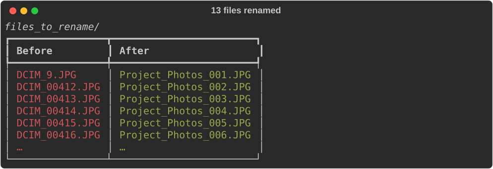

# Bulk File Renamer

**Script:** [`bulk_renamer.py`](../../bulk_renamer.py) · **Folder:** `files_to_rename/`

Turns hundreds of names like `DCIM_00412.jpg` into tidy, numbered names like `Project_Photos_001.jpg` — with a preview first and a one-command undo.



---

## How to use it

### 1. Put your files in the folder

Create (or let the script create) a folder named exactly `files_to_rename` next to the script. Copy the files **directly** into it (no subfolders). Any kind of file works: photos, PDFs, scans.

### 2. Run the script

```bash
python bulk_renamer.py
```

### 3. Type a base name, check the preview, confirm


Typing anything other than `y` cancels, and nothing is changed.

### 4. Changed your mind? Undo it

```bash
python bulk_renamer.py --undo
```

It shows a preview, asks you to type `y`, and puts every original name back. This works even if you renamed the files more than once.

---

## Good to know

- **Files are renamed in place.** Unlike the other tools, no copies are made (copying hundreds of photos would double the space they use). That's why it always previews, asks first, and can undo.
- **Sorting:** names are read the way a person reads them, so `DCIM_2` comes before `DCIM_10`. To number files by their last-modified date instead, set `SORT_BY = "date"` at the top of the script. This helps when photos come from several phones.
- **Numbers** have at least 3 digits (`001`). With 1000 or more files, every number gets 4 digits (`0001`) so the order stays right.
- **Extensions are kept exactly** as they were: `.JPG` stays `.JPG`.
- **Spaces** in your base name become `_`. Characters Windows can't use (`\ / : * ? " < > |`) are rejected, and you'll be asked again.
- **Nothing is ever overwritten.** If a new name is already taken, the tool stops before changing anything. If something goes wrong partway, every name is put back automatically.
- Files that already have the right name are skipped, so running it again with the same name does nothing.
- Hidden files, sub-folders, `Thumbs.db`, and `desktop.ini` are left alone.
- The undo information is saved in `files_to_rename/.rename_undo_log.csv`. Don't delete it if you might want to undo.

---

## Troubleshooting

| Problem | What to try |
|---------|-------------|
| No files found to rename | Put the files **directly** into `files_to_rename/` (not in a subfolder) |
| "Stopped before changing anything… already exists" | A file or folder already has one of the new names. Move it, or choose a different base name |
| "Something went wrong… open in another program" | Close the file in Photos, Excel, etc., then run again. Every name was already put back |
| "an earlier rename was interrupted" | The computer probably shut down mid-rename. Remove the `.bulk_renamer_tmp` ending from the listed files by hand (the undo log lists old and new names), then run again |

---

← [Back to all tools](../../README.md#2-the-tools)
