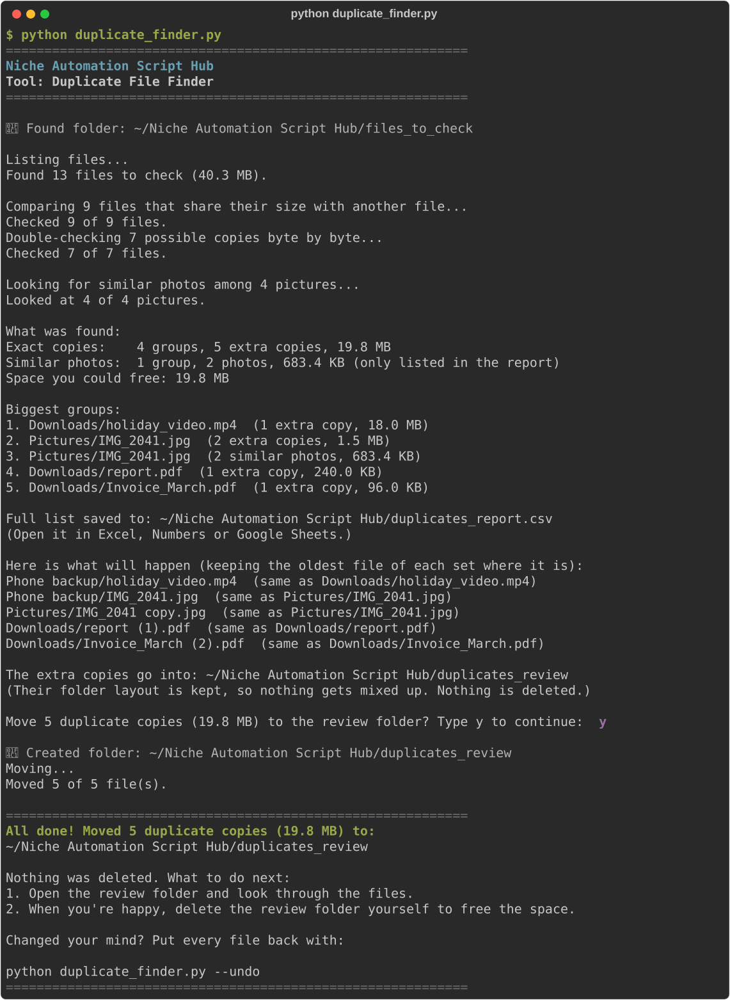

# Duplicate File Finder

**Script:** [`duplicate_finder.py`](../../duplicate_finder.py) · **Folder:** `files_to_check/` (or any folder you choose)

Finds files that are exact copies of each other, like `report.pdf` and `report (1).pdf`, plus photos that look the same (resized or converted copies). It moves the extra copies into a review folder so you can check them first. **It never deletes anything.**

---

## How to use it

### 1. Choose what to check

**Option A:** put files in the folder. Create (or let the script create) a folder named exactly `files_to_check` next to the script. Copy or move files into it. Sub-folders are fine: everything inside is checked.

**Option B:** check a folder where it already is, such as your Downloads folder. Type its path after the script name:

```bash
python duplicate_finder.py ~/Downloads
```

If the path contains spaces, put quotes around it:

```bash
python duplicate_finder.py "~/Pictures/Holiday 2024"
python duplicate_finder.py "C:\Users\Sam\My Pictures"
```

Tip: type `python duplicate_finder.py ` (with a space at the end), then drag the folder from Finder or File Explorer into the terminal window. Its full path is pasted for you, with any quotes it needs.

### 2. Run the script

```bash
python duplicate_finder.py
```



### 3. Check the summary, then confirm

The tool lists how many copies it found, how much space you could free, and the 5 biggest groups. It also saves the full list to `duplicates_report.csv`. Then it shows the first files it will move and asks:

```
Move 5 duplicate copies (19.8 MB) to the review folder? Type y to continue:
```

Typing anything other than `y` cancels, and nothing is moved.

### 4. Look through the review folder, then delete it yourself

The extra copies are now in a folder called `duplicates_review`. Open it, check the files, and when you're happy, delete the whole folder to free the space. (On a Mac, empty the Trash afterwards. Until then the space isn't freed.)

### 5. Changed your mind? Undo it

```bash
python duplicate_finder.py --undo
```

It shows a preview, asks you to type `y`, and moves every file back to exactly where it was. This works even if you ran the tool more than once, and also after checking another folder (it remembers the last one). To undo for a specific folder, add its path: `python duplicate_finder.py --undo "~/Downloads"`.

---

## Where things go

| What | Where |
|------|-------|
| Extra copies | `duplicates_review/` **next to** the folder you checked. For `files_to_check`, that's in the project folder. For `~/Downloads`, it's `~/duplicates_review/Downloads/…` |
| The report | `duplicates_report.csv` in the folder you ran the script from (the project folder). It is kept out of the checked folder so it never gets mixed in with your files. It's replaced each run |
| Undo log | `duplicates_review/.duplicates_undo_log.csv`. Don't delete it if you might want to undo (deleting the whole review folder is fine once you're happy) |

Inside the review folder, every file keeps its folder layout: `Downloads/Taxes/report (1).pdf` goes to `duplicates_review/Downloads/Taxes/report (1).pdf`. Two files with the same name never collide, and you can see where each one came from.

The report (`duplicates_report.csv`) opens in Excel, Numbers or Google Sheets. It has one row per extra copy, with these columns:

| Column | Meaning |
|--------|---------|
| `group` | Files with the same number belong together |
| `kept_file` | The copy that stays where it is |
| `duplicate_file` | The extra copy |
| `size` / `size_bytes` | How big the extra copy is (friendly, and in bytes for sorting) |
| `reason` | `exact` (identical contents) or `similar` (a photo that looks the same) |
| `plan` | `move to review folder`, or `only listed - check by eye` |

---

## Good to know

- **Nothing is ever deleted or overwritten.** Files are only moved, and only after you type `y`. If a spot in the review folder is already taken, the file gets a new name like `report (2).pdf`.
- **Exact copies** are found by comparing contents, not names. `IMG_2041 copy.jpg` and `IMG_2041.jpg` are duplicates if they hold the same picture. Two files called `notes.txt` with different text are not. To stay fast on big folders, it compares sizes first, then the start and end of each file, and only reads the remaining candidates completely (with a SHA-256 fingerprint).
- **Which copy stays:** by default the **oldest** one (by "last modified" date), because a downloaded-again or saved-again copy gets a newer date. Change `KEEP` at the top of the script to `"newest"` or `"shortest_path"` (keeps the copy with the fewest folders in its path, like `report.pdf` rather than `Backup/Old/report (1).pdf`). If dates are equal, the shorter path is kept.
- **Similar photos** (resized, recompressed, or converted copies such as `photo.png` and `photo.jpg`) are found with a "difference hash". Each picture is turned the right way up, shrunk to a tiny grayscale grid and compared. By default they are **only listed in the report**, not moved, because "looks the same" can be wrong: burst shots or two photos taken a second apart may look identical to a computer. To move them too, set `MOVE_SIMILAR_PHOTOS = True`. The version with the most pixels always stays. `SIMILARITY_THRESHOLD` (default `5`, maximum `20`) controls how alike photos must be; lower is stricter.
- **Skipped automatically:** hidden files and folders, empty (0-byte) files, shortcuts/symlinks, `Thumbs.db` and `desktop.ini`, unfinished downloads (`.crdownload`, `.part`), `node_modules`, any `duplicates_review` folder, and Mac "package" folders such as apps and the Photos library. Rearranging the inside of those would damage them.
- **Folders it refuses to check:** the top of a whole drive, your whole home folder, and system or app folders (like `C:\Windows`, `Program Files`, `AppData`, `/System`, `/usr`, `~/Library`). Apps often contain identical files on purpose, and moving them could break things. Choose a folder with your own files instead, like Downloads, Documents or Pictures.
- **Apps that keep their own list of your files** (for example music players or photo catalogs like Lightroom) may show a moved file as "missing". Use `--undo` to put it back, or check those folders with care.
- After moving, the original sub-folders stay where they are, even if one is now empty.

---

## Troubleshooting

| Problem | What to try |
|---------|-------------|
| No files found to check | Put files in `files_to_check/`, or type the folder's path after the script name. Hidden, empty and shortcut files are skipped |
| "Couldn't find a folder called…" | Check the spelling, put quotes around paths with spaces, or drag the folder into the terminal window |
| "…is a system or app folder" / "your whole home folder" | That folder is refused on purpose. Pick a folder inside it with your own files |
| "Similar photos: not checked (install Pillow…)" | Run `pip install Pillow`. Exact copies are still found without it |
| A file "was left where it was" | It was open in another program, changed during the check, or its kept copy disappeared. Close the program and run again |
| "Stopped before changing anything… is taken by another file now" (undo) | A new file now sits where a moved file came from. Move or rename it (it may be a newer copy you want), then run `--undo` again |
| The report couldn't be saved | `duplicates_report.csv` is probably open in Excel. Close it and run again |

---

← [Back to all tools](../../README.md#2-the-tools)
