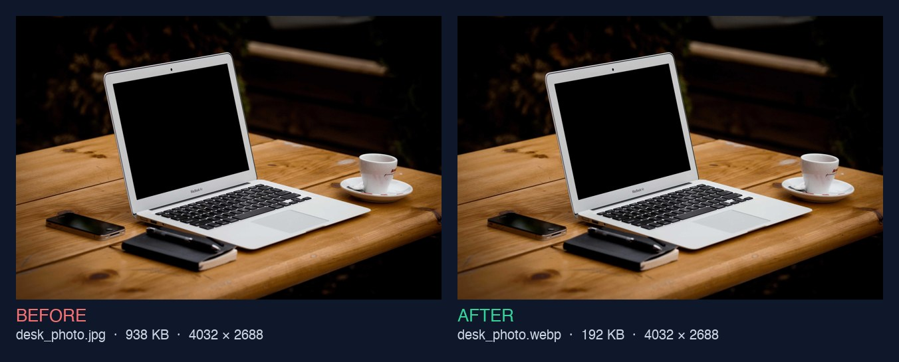
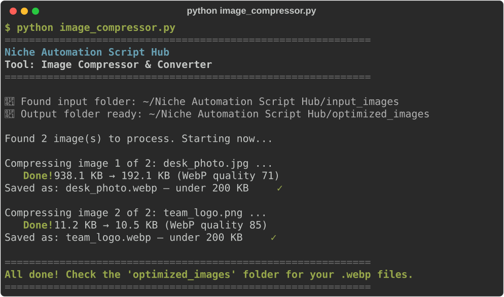

# Image Compressor & Converter

**Script:** [`image_compressor.py`](../../image_compressor.py) · **Input:** `input_images/` · **Output:** `optimized_images/`

Shrinks JPG and PNG pictures to modern `.webp` files, aiming for **under 200 KB** each, so they're easy to email, upload, and share.



---

## How to use it

### 1. Put your photos in the input folder

Create (or let the script create) a folder named exactly `input_images` next to the script. Copy `.jpg`, `.jpeg`, or `.png` files **directly** into it (no subfolders, no HEIC/PDF).

### 2. Run the script

```bash
python image_compressor.py
```

### 3. Watch the progress



### 4. Get your finished files

Open `optimized_images/`. Every finished picture is a `.webp` file with the same name as the original.

**Your originals in `input_images/` are never changed.**

---

## How it keeps pictures looking good

1. It first lowers the WebP quality, but never below 60 (below that, photos start to look smudgy).
2. Full-size phone photos (12 megapixels and up) often can't reach 200 KB that way, so the tool then shrinks the width and height a little at a time. It never goes below 1280 pixels on the longest side, which still looks sharp on screens and in documents.
3. If a picture still can't reach 200 KB (very detailed images sometimes can't), it keeps the best-looking small version and tells you.

It also turns sideways phone photos the right way up, keeps transparent PNG backgrounds transparent, and keeps the original colors. Phone location (GPS) data is **not** copied into the new file.

If two files share a name (`photo.jpg` and `photo.png`), the second is saved as `photo_png.webp` so nothing is overwritten.

---

## Troubleshooting

| Problem | What to try |
|---------|-------------|
| `No module named 'PIL'` | `pip install Pillow` or `pip install -r requirements.txt` |
| No images found | Put `.jpg` / `.png` files **directly** into `input_images/` (not in a subfolder) |
| iPhone photos (`.heic`) are ignored | Export them as JPG first (on iPhone: Settings → Camera → Formats → *Most Compatible*) |
| Image still over 200 KB | Very detailed pictures sometimes can't reach 200 KB without looking bad; the tool keeps the best-looking small version |

---

← [Back to all tools](../../README.md#2-the-tools)
