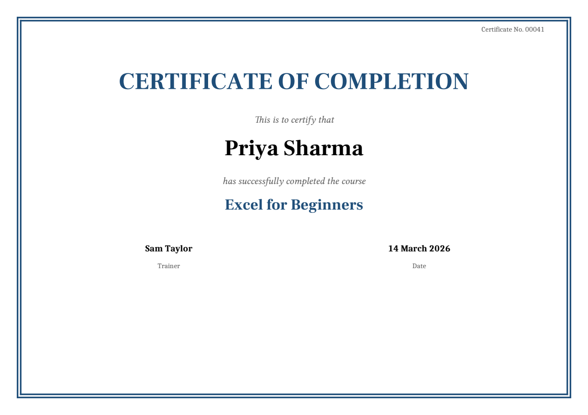
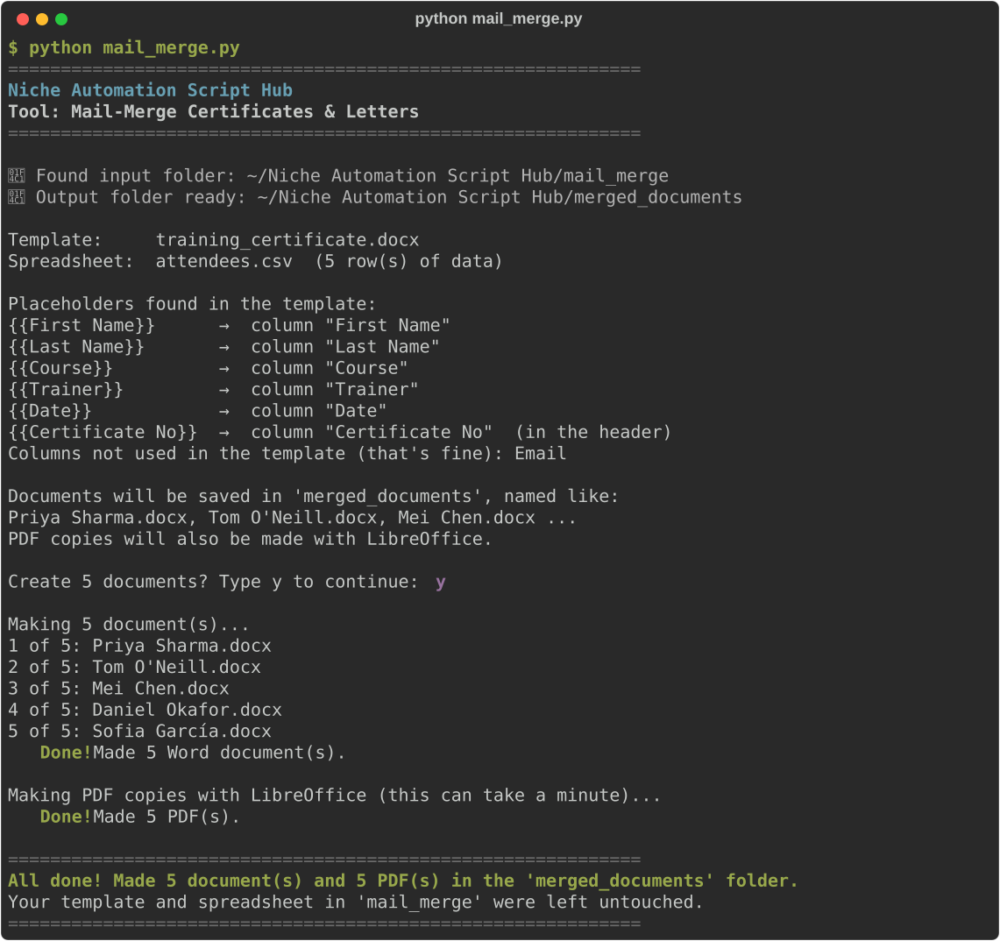

# Mail-Merge Certificates & Letters

**Script:** [`mail_merge.py`](../../mail_merge.py) · **Input:** `mail_merge/` · **Output:** `merged_documents/`

Turns one Word template and one spreadsheet of people into one personalised Word document per row, plus a PDF copy if you have LibreOffice. Use it for certificates, offer letters, invitations, award letters, and name badges.



---

## How to use it

### 1. Make a Word template

Write your document in Word as usual. Wherever a person's details should go, type the spreadsheet's **column heading inside double curly braces**:

```text
                 CERTIFICATE OF COMPLETION

                  This is to certify that
                 {{First Name}} {{Last Name}}
            has successfully completed the course
                        {{Course}}

        {{Trainer}}                          {{Date}}
          Trainer                              Date
```

The matching spreadsheet has one column per placeholder and one person per row:

| First Name | Last Name | Course | Date | Trainer | Certificate No |
|------------|-----------|--------|------|---------|----------------|
| Priya | Sharma | Excel for Beginners | 14 March 2026 | Sam Taylor | 00041 |
| Tom | O'Neill | First Aid at Work | 21 March 2026 | Alex Morgan | 00042 |

- Capital letters and extra spaces don't matter: `{{first name}}` and `{{ FIRST NAME }}` both match the column `First Name`.
- **Format each placeholder the way the result should look.** If `{{First Name}}` is bold, 32 pt, and blue, the name will be too. Everything else in the template (fonts, colours, pictures, logos, page borders) is kept exactly.
- Placeholders work in normal text, tables, headers, footers, and text boxes.
- You can use a placeholder more than once, and you don't have to use every column.

**Not sure where to start?** Run the script with an empty `mail_merge/` folder. It adds `example_template.docx` (a certificate) and `example_people.csv` (3 people). Type `y` to see the result, then open the example template in Word to see how it's made.

### 2. Put the template and spreadsheet in the input folder

Put **one** Word template (`.docx`) and **one** spreadsheet in `mail_merge/`. Supported spreadsheet types:

- `.xlsx` (modern Excel — recommended)
- `.xls` (older Excel)
- `.csv`

Column headings must be in the **first row**. In an Excel workbook, the **first sheet** is used. If the folder has more than one template or spreadsheet, the script lists them and asks you to type the number of the one to use.

### 3. Run the script, check, and type `y`

```bash
python mail_merge.py
```



Before anything is made, the script shows a check:

- every placeholder it found, and the column it matched
- columns the template doesn't use (that's fine)
- how many documents it will make, and their file names

If a placeholder doesn't match any column, the script stops and suggests the closest column name (for example, `{{Frist Name}}  (did you mean {{First Name}}?)`). Fix the spelling in the template or the spreadsheet, then run it again.

Typing anything other than `y` cancels, and nothing is created.

### 4. Get your documents

Open `merged_documents/`:

| You put this in `mail_merge` | You get this in `merged_documents` |
|------------------------------|------------------------------------|
| `certificate.docx` + `people.xlsx` (3 rows) | `Priya Sharma.docx`, `Tom O'Neill.docx`, `Mei Chen.docx` |
| …and LibreOffice is installed | the same names as `.pdf` too |

**Your template and spreadsheet are never changed.**

---

## How values are filled in

Values go into the documents exactly as they are in the spreadsheet:

- ID numbers keep their leading zeros (`00041` stays `00041`).
- Text like `N/A`, `£2.50`, or `Smith & Co` stays as typed.
- **Real dates in Excel** are written like `05 March 2026`. Change `DATE_FORMAT` at the top of the script for a different style (for example `"%d/%m/%Y"` → `05/03/2026`, or `"%B %d, %Y"` → `March 05, 2026`).
- Dates in a **CSV file** are plain text, so they appear exactly as typed.
- Whole numbers appear without a stray `.0` (`12`, not `12.0`).
- Empty cells become empty, and completely empty rows are skipped.
- Line breaks inside a cell (Alt+Enter in Excel) stay as line breaks.

Excel's number *formatting* isn't copied: a cell showing `£2.50` or `15%` really holds `2.5` or `0.15`. To show the formatted text, type it in the cell as text, or format that column as **Text** in Excel before typing.

## File names

Each document is named after the person, using `FILE_NAME_PATTERN = "{{First Name}} {{Last Name}}"` at the top of the script. Use any columns you like, for example `"{{Certificate No}} {{Last Name}}"`.

- Characters Windows can't use (`\ / : * ? " < > |`) become `_`.
- If two people have the same name, the second becomes `Ada Lovelace_2.docx`, so nothing is lost.
- Rows with nothing to put in the name are called `Document_001.docx`, `Document_002.docx`, and so on. This is also used if the pattern names a column your spreadsheet doesn't have.
- Running the script again replaces documents with the same names, so you can fix a typo in the spreadsheet and simply run it again.

## PDF copies

PDFs are made by [LibreOffice](https://www.libreoffice.org/download/), a free office program. Install it once and the script finds it by itself (on Windows, Mac, and Linux). Without it, you still get all the Word documents, and the script explains how to get PDFs.

Settings at the top of the script:

| Setting | What it does |
|---------|--------------|
| `MAKE_PDFS = True` | Make a PDF copy of every document. Set to `False` for Word files only. |
| `COMBINE_INTO_ONE_PDF = False` | Set to `True` to also join every PDF into `All documents.pdf`, handy for printing every certificate in one go. |

---

## Troubleshooting

| Problem | What to try |
|---------|-------------|
| `No module named 'docxtpl'` | `pip install docxtpl pandas openpyxl xlrd` or `pip install -r requirements.txt` |
| "don't match any column heading" | Make the placeholder and the column heading use the same words, then run again |
| "missing a brace" | Each placeholder needs two braces on each side: `{{First Name}}`, not `{First Name}}` |
| "partly inside a link, a tracked change…" | Accept all tracked changes in Word, then delete the placeholder and type it again in one go |
| A `.doc` file "can't be used as a template" | Open it in Word, choose **File → Save As**, and pick **Word Document (.docx)** |
| A date shows as text you didn't expect | In a CSV, dates are used exactly as typed. In Excel, change `DATE_FORMAT` |
| "Skipped row… open in another program" | Close that document in Word, then run again |
| "LibreOffice didn't create any PDFs" | Check LibreOffice opens normally on its own, or reinstall it. Your Word files are already saved |

---

← [Back to all tools](../../README.md#2-the-tools)
