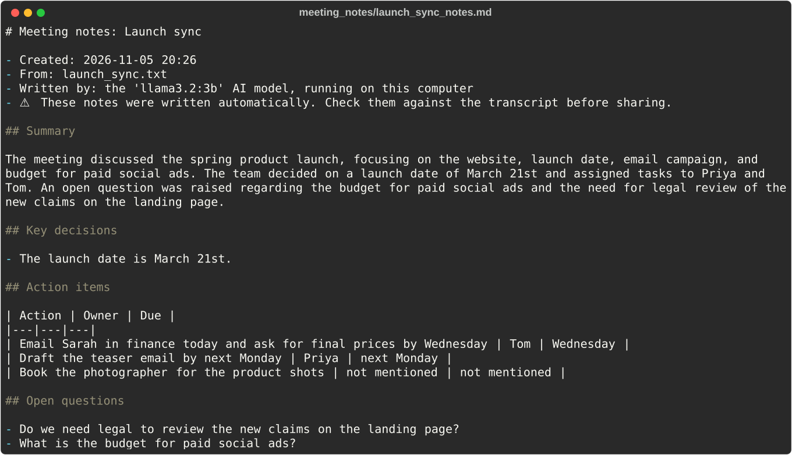
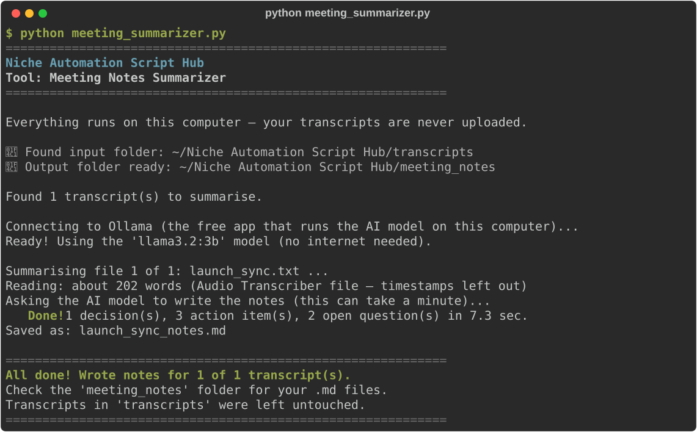

# Meeting Notes Summarizer

**Script:** [`meeting_summarizer.py`](../../meeting_summarizer.py) · **Input:** `transcripts/` · **Output:** `meeting_notes/`

Turns meeting transcripts into ready-to-share notes: a short summary, the key decisions, a table of action items (what, who, and by when), and the questions that are still open. It is the natural next step after the [Audio-to-Text Transcriber](audio-transcriber.md): record the meeting, transcribe it, then summarise it.

**Private by design:** the notes are written by an AI model that runs on your own computer, using the free [Ollama](https://ollama.com) app. Your transcripts are never uploaded anywhere.



---

## Setup: install Ollama (one time)

This tool needs no extra Python libraries, but it does need the free Ollama app, which runs the AI model.

- **Windows:** download the installer from [ollama.com/download](https://ollama.com/download), run it, then open **Ollama** from the Start menu.
- **Mac:** download the app from [ollama.com/download](https://ollama.com/download), drag it into **Applications**, then open it once. (Homebrew users can run `brew install ollama` instead.)
- **Linux:** open a terminal and run:

  ```bash
  curl -fsSL https://ollama.com/install.sh | sh
  ```

When the app is open, you'll see the Ollama llama icon in your taskbar (Windows) or menu bar (Mac). On Linux, Ollama starts in the background on its own; if it doesn't, run `ollama serve` in a separate terminal window.

You don't need to download a model yourself. The script does that automatically the first time.

## How to use it

### 1. Put your transcripts in the input folder

Transcripts made by the [Audio-to-Text Transcriber](audio-transcriber.md) are already in the right place: the `transcripts` folder. You can also copy your own meeting transcripts or rough notes (`.txt` or `.md`) **directly** into that folder. If it doesn't exist yet, the script creates it for you.

The script recognises the transcriber's files and only uses their plain-text part, so the timestamps and header lines don't confuse the AI. Timestamps like `[00:01:23]` are removed from your own files too.

### 2. Run the script

Make sure the Ollama app is open, then run:

```bash
python meeting_summarizer.py
```

### 3. Watch the progress



The **first time** you run it, it downloads the AI model (about 2 GB). This needs internet and can take a few minutes. After that it works offline. A short meeting then takes about 10 to 30 seconds on a normal laptop.

### 4. Get your notes

Open `meeting_notes/`. Each transcript gets a Markdown file with `_notes` added to its name (`team_standup.txt` → `team_standup_notes.md`) containing:

1. A title made from the file name, the date it was created, and the AI model that wrote it.
2. **Summary**: a few sentences about what the meeting covered and what came out of it.
3. **Key decisions**: what the group agreed.
4. **Action items**: a table with the action, the owner, and the due date.
5. **Open questions**: things that were raised but not settled.

**Your transcripts in `transcripts/` are never changed.** Running the script again replaces the older notes with fresh ones.

---

## Good to know

- **Always check the notes before sharing them.** AI models can misunderstand or miss things, so each notes file says it was written automatically.
- **Owners and due dates are never guessed.** If the transcript doesn't name who will do something, or by when, the table says *not mentioned*. Transcripts don't label who is speaking, so "I'll do it" also becomes *not mentioned*. Fill these in yourself.
- **Long meetings** are split into parts of about 3,000 words (roughly 20 minutes of talking). Each part is summarised, then the parts are combined into one set of notes. This takes longer, and the progress is shown as it goes.
- **Other languages:** the notes are written in the language of the transcript. Larger models handle languages other than English much better.
- **If the AI's answer comes out jumbled**, the script asks it once more. If it's still jumbled, the AI's text is saved as it is, and the script tells you so you can tidy it by hand.
- **Better notes or more speed, if you need it:** set `MODEL` at the top of the script:

  | Model | One-time download | Best for |
  |---|---|---|
  | `"llama3.2:1b"` | ~1.3 GB | Older laptops; short, simple meetings |
  | `"llama3.2:3b"` (default) | ~2.0 GB | Everyday meetings on most laptops (8 GB memory) |
  | `"qwen2.5:7b"` | ~4.7 GB | Noticeably better notes, 2 to 3 times slower (16 GB memory) |

  Any other model from the [Ollama library](https://ollama.com/library) works too. The new model downloads automatically the next time you run the script.

---

## Troubleshooting

| Problem | What to try |
|---------|-------------|
| "Ollama isn't installed on this computer yet" | Follow **Setup: install Ollama** above, open the app, and run the script again |
| "Ollama is installed, but it isn't running right now" | Open the Ollama app (or run `ollama serve` in another terminal), wait a few seconds, and run again |
| "The AI model could not be downloaded" | The first run needs internet and about 2 GB of free disk space. Check both and run again; the download picks up where it stopped |
| "doesn't have enough free memory" | Close other apps, or switch `MODEL` to `"llama3.2:1b"` |
| "the AI model took longer than 10 min to answer" | Your computer is busy or the model is too big for it. Close other apps, or switch to `"llama3.2:1b"` |
| "your Ollama app is too old for this tool" | Download the latest version from [ollama.com](https://ollama.com) and install it over the old one |
| An owner or due date says *not mentioned* | The transcript didn't say it clearly, so the AI didn't guess. Add it yourself |

---

← [Back to all tools](../../README.md#2-the-tools)
