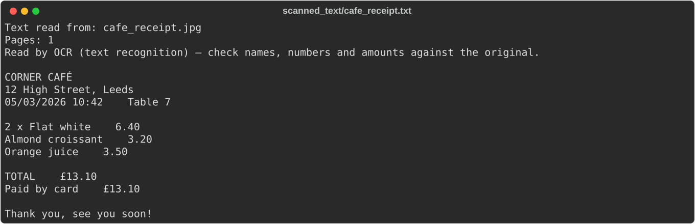
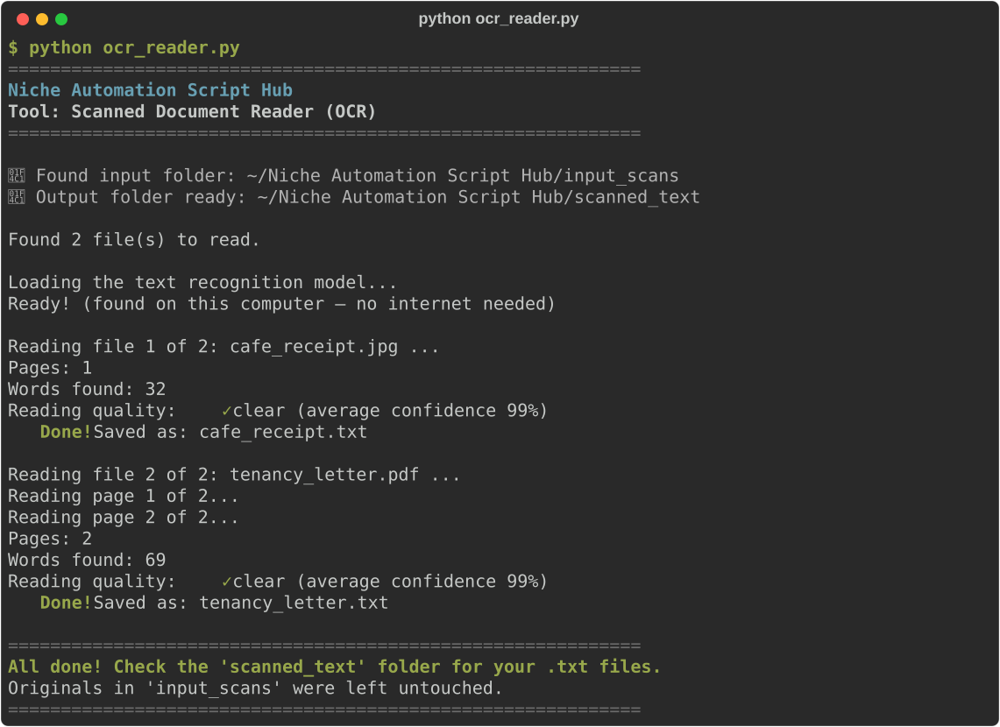

# Scanned Document Reader (OCR)

**Script:** [`ocr_reader.py`](../../ocr_reader.py) · **Input:** `input_scans/` · **Output:** `scanned_text/`

Reads the words in scanned PDFs, photos of letters, receipts and whiteboards, and screenshots, then saves them as a `.txt` file you can open in Notepad, TextEdit, or Word. Use it when the [PDF Extractor](pdf-extractor.md) says a PDF "is probably scanned".

**Private by design:** the text recognition (OCR) runs entirely on your own computer. Your documents are never uploaded anywhere.



---

## How to use it

### 1. Put your scans in the input folder

Create (or let the script create) a folder named exactly `input_scans` next to the script. Copy your files **directly** into it (no subfolders).

Supported: `.pdf`, `.jpg` / `.jpeg`, `.png`, `.tif` / `.tiff` (including multi-page scanner and fax files), `.bmp`, and `.webp`. Other file types are listed and skipped.

### 2. Run the script

```bash
python ocr_reader.py
```

### 3. Watch the progress



For each file you see the number of pages and words found, plus a **reading quality** hint:

| Reading quality | What it means |
|---|---|
| ✓ clear | The OCR was confident. Still worth a glance at important numbers. |
| fair | A few words may be wrong. Check names, amounts and dates. |
| ⚠️ poor | Some words may be wrong. Check the original, or try a sharper photo. |
| ✓ exact | The PDF already contained real typed text, which was copied exactly. |

Long PDFs show `Reading page 3 of 12...` as they go, so they never look frozen. A normal page takes a few seconds.

### 4. Get your results

Open `scanned_text/`. Each file gets a `.txt` file with the same name:

| You put this in `input_scans` | You get this in `scanned_text` |
|---|---|
| `receipt.jpg` | `receipt.txt`: the words, line by line, in reading order |
| `signed_lease.pdf` (4 pages) | `signed_lease.txt`, with a `----- Page 1 of 4 -----` line above each page |
| `receipt.jpg` **and** `receipt.pdf` | `receipt.txt` and `receipt_pdf.txt` (nothing gets overwritten) |

Lines are rebuilt top to bottom and left to right, even if the photo is slightly tilted. Paragraph gaps are kept, and on receipts and forms the item and its price stay on the same line, separated by a few spaces.

**Your originals in `input_scans/` are never changed.**

---

## Good to know

- **Languages:** it reads English and most languages written with the Latin alphabet, including accents (French, German, Spanish, Italian, Portuguese, Dutch, Polish, Turkish, Swedish and more), plus Chinese and Japanese. It does **not** read Russian or other Cyrillic text, Greek, Korean, Arabic, Hebrew or Hindi. Vietnamese mostly works, but stacked accents are often dropped.
- **Printed text works best.** Handwriting is often misread or missed.
- **Always check important details.** OCR can confuse similar characters (`0` and `O`, `1` and `l`), so double-check names, amounts and account numbers against the original.
- **PDFs that already contain real text:** if a page already has typed text (for example, a PDF made in Word or a "searchable" scan), that text is copied exactly instead of being guessed by OCR. The summary tells you how many pages this happened to.
- **Phone photos** are turned the right way up automatically. Photos taken straight on, in good light, give the best results. Shadows, blur and steep angles make it harder.
- **Multi-column layouts:** text that sits side by side (like newspaper columns) is read across the page, line by line, so the columns get mixed together. Tables come out as rows of words with spaces between them.
- **Sideways or upside-down scans** (with no rotation information in the file) aren't straightened. Rotate the page in your PDF viewer or photo app first.
- **Huge photos** are shrunk to about 12 megapixels before reading, which is still plenty sharp for text and keeps things fast.
- **Blank pages and photos without writing** are reported as "No text found". A blank page inside a PDF is marked `[No text found on this page]`.
- **Password-protected PDFs** are skipped with a clear message. PDFs that are only locked against editing or printing open fine.
- **iPhone photos (`.heic`)** aren't supported. Export or share them as JPEG, or set *Settings → Camera → Formats → Most Compatible* on the iPhone.
- **Internet:** the text model comes included when you install the tool, so normally no internet is needed. If its files are ever missing or damaged, the script downloads them once (about 32 MB, from modelscope.cn) and tells you it's doing so.
- **Fine-tuning:** the top of `ocr_reader.py` has settings you can change, such as `PDF_DPI` (sharper but slower PDF pages) and `MIN_CONFIDENCE` (how sure the OCR must be before a word is kept).
- Running the script again replaces the earlier text files.

---

## Troubleshooting

| Problem | What to try |
|---------|-------------|
| `No module named 'rapidocr'` (or `onnxruntime`, `pypdfium2`) | `pip install rapidocr onnxruntime pypdfium2 pypdf Pillow` or `pip install -r requirements.txt` |
| Windows: "Windows is missing a free Microsoft helper" | Install the [Microsoft Visual C++ Redistributable (x64)](https://aka.ms/vs/17/release/vc_redist.x64.exe), restart, and run again |
| "The text recognition model could not be downloaded" | Check your internet connection. Work networks sometimes block modelscope.cn. Or reinstall with `pip install --force-reinstall rapidocr`, which includes the model |
| "No text found" but there is writing | Use a sharper, brighter, straight-on photo. For PDFs, try `PDF_DPI = 300` in the script |
| Reading quality is "poor" | Rescan at a higher resolution, avoid shadows and glare, and check the result against the original |
| PDF skipped: "password-protected" | Open it with the password, save or "Print to PDF" a copy without a password, and put that copy in `input_scans/` |
| A picture is skipped as "far too big" | Shrink it in a photo editor (under about 50 megapixels) and run again |

---

← [Back to all tools](../../README.md#2-the-tools)
