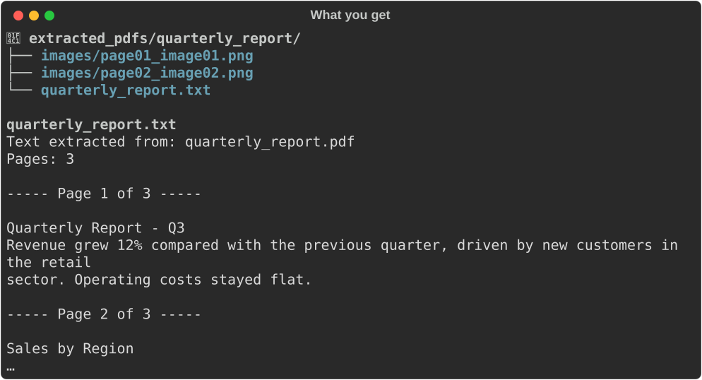
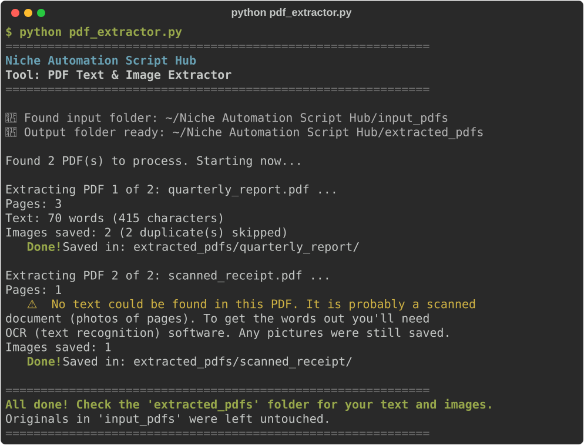

# PDF Text & Image Extractor

**Script:** [`pdf_extractor.py`](../../pdf_extractor.py) · **Input:** `input_pdfs/` · **Output:** `extracted_pdfs/`

Pulls all the text out of a PDF into a clean `.txt` file (opens in Notepad, TextEdit, or Word) and saves every picture inside it into a folder.



---

## How to use it

### 1. Put your PDFs in the input folder

Create (or let the script create) a folder named exactly `input_pdfs` next to the script. Copy your `.pdf` files **directly** into it (no subfolders).

### 2. Run the script

```bash
python pdf_extractor.py
```

### 3. Watch the progress



### 4. Get your results

Each PDF gets its own folder inside `extracted_pdfs/`:

| You put this in `input_pdfs` | You get this in `extracted_pdfs` |
|---|---|
| `report.pdf` | `report/report.txt` — all the text, with a `----- Page 1 of 12 -----` line above each page |
| `report.pdf` (with pictures) | `report/images/page01_image01.png`, `page03_image02.jpg`, … |

Accents and symbols are kept, and big gaps of empty lines are tidied up. Picture names tell you which page each picture came from. The `images` folder only appears if the PDF has pictures.

**Your originals in `input_pdfs/` are never changed.**

---

## Good to know

- **Scanned PDFs** (photos of paper pages) have no real text inside, so the text file will be empty. You need OCR (text recognition) software to read them. The page pictures are still saved.
- **Repeated pictures**, like a logo on every page, are saved only once. The summary tells you how many copies were skipped.
- **Password-protected PDFs** are skipped with a clear message. PDFs that are only locked against editing or printing still open fine.
- **Strong (AES) protection** needs one extra install: `pip install cryptography`.
- **Text order** follows how the PDF was built. Tables and multi-column layouts may come out in a slightly different order than you see on screen.
- **Unusual picture formats** are saved as-is. Some PDFs store pictures as `.jp2` (JPEG 2000), which Windows Photos can't open. A web browser or GIMP can.
- Running the script again replaces the earlier results for that PDF.

---

## Troubleshooting

| Problem | What to try |
|---------|-------------|
| `No module named 'pypdf'` | `pip install pypdf` or `pip install -r requirements.txt` |
| PDF skipped: "needs one extra helper library" | `pip install cryptography`, then run again |
| PDF skipped: "password-protected" | Open it with the password, save or "Print to PDF" a copy without a password, and put that copy in `input_pdfs/` |
| Text file says "No text could be found" | The PDF is probably scanned; use an OCR tool to turn it into text |

---

← [Back to all tools](../../README.md#2-the-tools)
