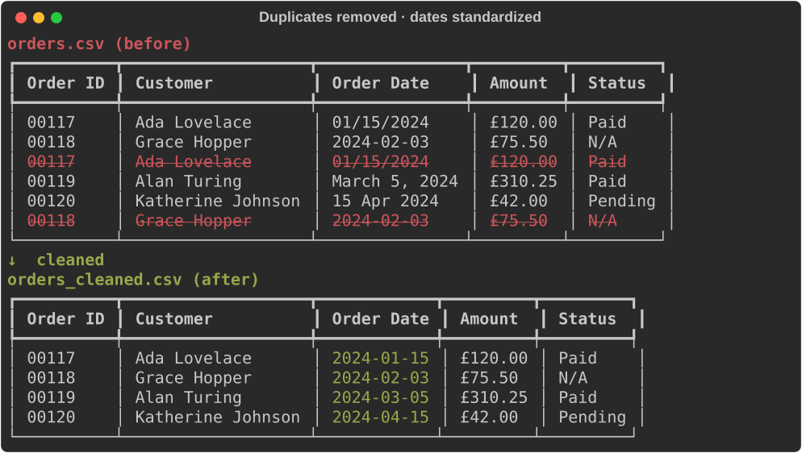
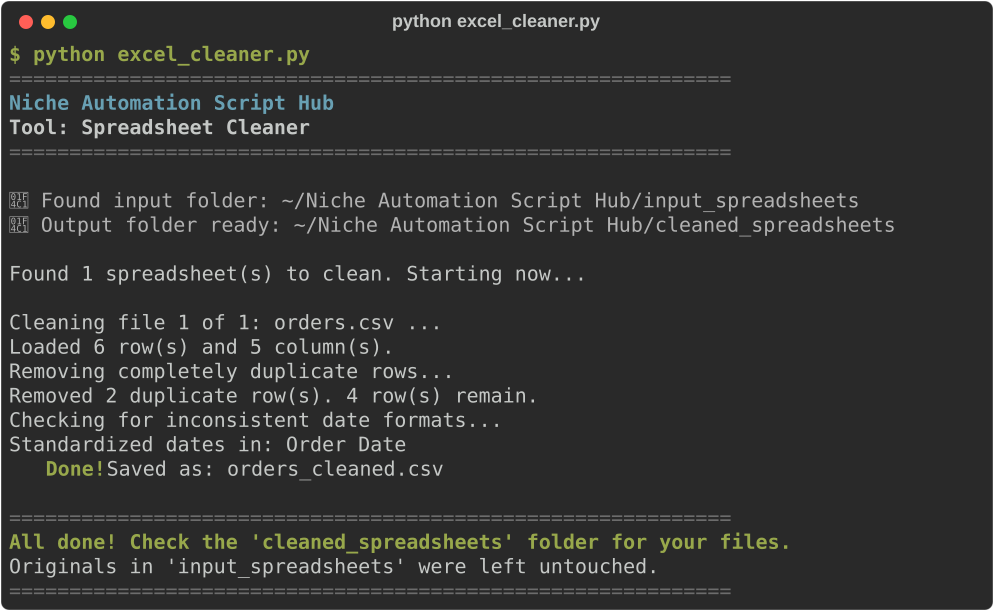

# Spreadsheet Cleaner

**Script:** [`excel_cleaner.py`](../../excel_cleaner.py) · **Input:** `input_spreadsheets/` · **Output:** `cleaned_spreadsheets/`

Removes completely duplicate rows and turns messy dates into one standard format (`YYYY-MM-DD`). Saves a new file with `_cleaned` in the name.



---

## How to use it

### 1. Put your spreadsheets in the input folder

Use the folder `input_spreadsheets/`. Supported types:

- `.xlsx` (modern Excel — recommended)
- `.xls` (older Excel — cleaned copy is saved as `.xlsx`)
- `.csv`

### 2. Run the script

```bash
python excel_cleaner.py
```

### 3. Watch the progress



### 4. Get your cleaned files

Open `cleaned_spreadsheets/`:

| You put this in `input_spreadsheets` | You get this in `cleaned_spreadsheets` |
|--------------------------------------|----------------------------------------|
| `sales.xlsx` | `sales_cleaned.xlsx` |
| `contacts.csv` | `contacts_cleaned.csv` |
| `legacy.xls` | `legacy_cleaned.xlsx` |

**Your originals are never changed.**

---

## What it changes — and what it leaves alone

It changes only two things:

1. Removes **completely duplicate rows** (every column matches).
2. Standardizes date-like columns to **`YYYY-MM-DD`** (example: `2024-03-15`).

Everything else is kept exactly as you typed it:

- ID numbers keep their leading zeros (`00123` stays `00123`).
- Text like `N/A`, `null`, or `TBD` stays as typed instead of becoming blank.
- Years, hours, and times of day (`2024`, `8.5`, `09:30`) are not mistaken for dates.
- Every sheet in an Excel workbook is cleaned and kept, with the same sheet names.
- CSV files saved by Excel on Windows (with `£` or `é` in them) open correctly.

### Date format notes

- If a column also has times, they are kept: `2024-03-15 14:30`.
- A value only counts as a date if it shows a year (like `2024` inside `15 Mar 2024`, or a short date like `15/03/24`).
- Columns named things like `Date`, `Order Date`, `DOB`, or `Deadline` are cleaned when at least half their values are dates. Other columns change only if almost all values clearly look like dates.
- Values in a date column that aren't dates (like `TBD`) are left as they are.
- Ambiguous values like `01/02/2024` are read as **month/day/year** (US style). If your office uses day/month/year, spot-check a few rows.
- In Excel files, cleaned dates are saved as text so they always show as `YYYY-MM-DD`.

---

## Troubleshooting

| Problem | What to try |
|---------|-------------|
| `No module named 'pandas'` | `pip install pandas openpyxl xlrd` or `pip install -r requirements.txt` |
| Error mentioning `openpyxl` or `xlrd` | `pip install openpyxl xlrd` |
| No Excel/CSV found | Put `.xlsx` / `.xls` / `.csv` files **directly** into `input_spreadsheets/` |
| Dates look wrong (day/month swapped) | Your file may use day-first dates — spot-check and fix those columns in Excel |
| "Could not save" / access denied | Close the file in Excel, then run the tool again |

---

← [Back to all tools](../../README.md#2-the-tools)
