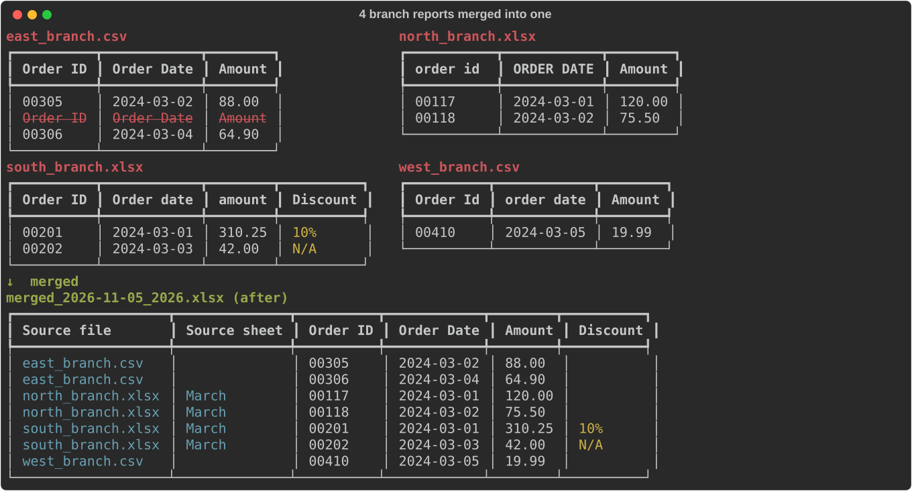
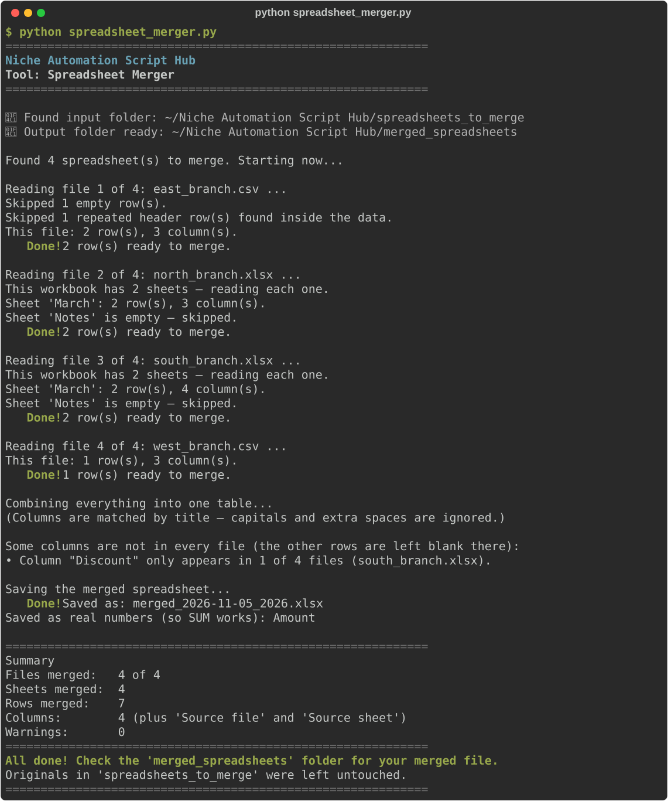

# Spreadsheet Merger

**Script:** [`spreadsheet_merger.py`](../../spreadsheet_merger.py) · **Input:** `spreadsheets_to_merge/` · **Output:** `merged_spreadsheets/`

Combines many Excel or CSV files, such as the monthly report from each branch, into **one** spreadsheet. Columns are matched by their title, and every row is labelled with the file it came from.



---

## How to use it

### 1. Put your spreadsheets in the input folder

Use the folder `spreadsheets_to_merge/` (it is created the first time you run the tool). Supported types:

- `.xlsx` (modern Excel — recommended)
- `.xls` (older Excel)
- `.csv` (including CSVs saved by Excel on Windows, and `;`-separated CSVs)

Every sheet of every workbook is included. Each sheet needs a row of column titles at the top.

### 2. Run the script

```bash
python spreadsheet_merger.py
```

### 3. Watch the progress



The tool tells you which columns are missing from some files, and it warns you about any file that shares no columns with the others, because that file may be a different kind of report.

### 4. Get your merged file

Open `merged_spreadsheets/`. You get one new file named after the date and time, for example:

| You put this in `spreadsheets_to_merge` | You get this in `merged_spreadsheets` |
|-----------------------------------------|---------------------------------------|
| `north.xlsx`, `south.xlsx`, `east.csv`, `west.csv` | `merged_2024-03-15_0930.xlsx` |

The merged file has a **bold header row** that stays in place when you scroll, filter buttons on every column, and columns wide enough to read.

**Your originals are never changed, and an earlier merged file is never overwritten.** If you run the tool twice in the same minute, the second file gets `_2` on the end.

---

## What it does

- **Matches columns by title, ignoring capitals and extra spaces.** `Order Date`, `order date ` and `ORDER  DATE` all go into one column. The spelling and order from the first file that has the column are used.
- **Keeps columns that only some files have.** They are added on the right, and rows from the other files are left blank there. The tool lists them, for example: `Column "Discount" only appears in 3 of 12 files`.
- **Adds `Source file` and `Source sheet` columns** at the front, so you can trace every row back. `Source sheet` is blank for CSV files.
- **Skips completely empty rows and empty sheets.**
- **Skips header rows pasted into the middle of the data.** This often happens when blocks of data were copied and pasted together.

### What it leaves alone

- ID numbers keep their leading zeros (`00123` stays `00123`).
- Text like `N/A`, `null`, or `TBD` stays as typed instead of becoming blank.
- Dates from Excel are written as `2024-03-15` (or `2024-03-15 14:30` if there is a time). Dates typed as text are kept exactly as typed. Use the [Spreadsheet Cleaner](spreadsheet-cleaner.md) afterwards if they need standardizing.
- Duplicate rows are kept (see the settings below).

### Numbers in the Excel file

If **every** value in a column is a plain number (like `120` or `75.50`), the column is saved as real numbers so `SUM` and sorting work straight away. `75.50` still shows as `75.50`.

A column stays as text if any of these are true, so IDs are never damaged:

- Any value has a leading zero (`00123`, `07946 201234`).
- Any value is longer than 11 digits (card numbers, barcodes).
- Any value is not a plain number (`£2.50`, `1,200`, `N/A`).
- The title suggests an ID or code (`Order ID`, `Product Code`, `Phone`, `Postcode`, `SKU`).

---

## Settings you can change

Open `spreadsheet_merger.py` in a text editor. Near the top, under **Settings you can tweak later**:

| Setting | Default | What it does |
|---------|---------|--------------|
| `USE_ONLY_FIRST_SHEET` | `False` | `True` uses only the first sheet of each workbook. Useful if every workbook also has a `Notes` or `Summary` sheet. |
| `ADD_SOURCE_COLUMNS` | `True` | `False` leaves out the `Source file` and `Source sheet` columns. |
| `ALSO_SAVE_CSV` | `False` | `True` also saves a `.csv` copy with the same name. The CSV keeps every value as plain text. |
| `REMOVE_DUPLICATES` | `False` | `True` removes rows that are identical to an earlier row, even from different files. It is off because identical rows are often real data, such as two customers buying the same thing on the same day. Turn it on only if your files overlap, like the same report saved twice. |
| `SAVE_NUMBERS_AS_NUMBERS` | `True` | `False` saves every value as text, exactly as typed. |

---

## Troubleshooting

| Problem | What to try |
|---------|-------------|
| `No module named 'pandas'` | `pip install pandas openpyxl xlrd` or `pip install -r requirements.txt` |
| Error mentioning `openpyxl` or `xlrd` | `pip install openpyxl xlrd` |
| No Excel/CSV found | Put `.xlsx` / `.xls` / `.csv` files **directly** into `spreadsheets_to_merge/` (not in a subfolder) |
| A title like "Branch report – March" became a column | The tool uses the first filled-in row as the column titles. Delete any title rows above the real column titles, then run again. |
| The same column appears twice with different names | The titles are spelled differently (for example `Qty` and `Quantity`). Rename one of them in the original file, then run again. |
| "No column titles in common with the other files" | That file is probably a different kind of report. Move it out of the folder, or set `USE_ONLY_FIRST_SHEET = True` if it is an extra sheet. |
| Leading zeros missing from an Excel ID | In the original file the ID is a number shown with extra zeros by its cell format. Format that column as **Text** in Excel and retype the IDs, or save the file as CSV. |
| A file was skipped | Read the reason under its name. If it says the file could not be opened, open it in Excel and save it again as `.xlsx`. |

---

← [Back to all tools](../../README.md#2-the-tools)
