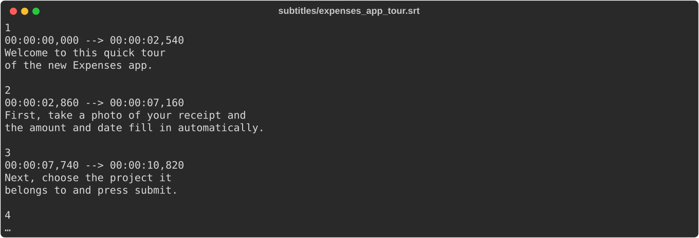
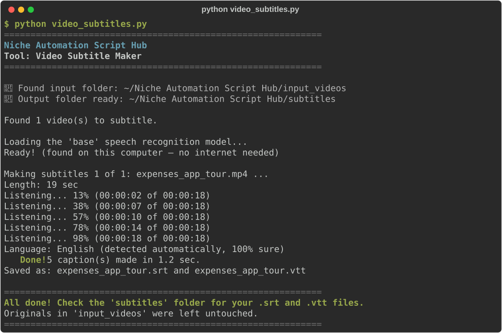

# Video Subtitle Maker

**Script:** [`video_subtitles.py`](../../video_subtitles.py) · **Input:** `input_videos/` · **Output:** `subtitles/`

Makes subtitle files for your videos: training videos, webinars, screen recordings, social media clips. Each video gets an `.srt` and a `.vtt` file with short, readable captions timed to the speech.

**Private by design:** the speech recognition runs entirely on your own computer. Your videos are never uploaded anywhere.



---

## How to use it

### 1. Put your videos in the input folder

Create (or let the script create) a folder named exactly `input_videos` next to the script, and copy your videos **directly** into it.

Supported: `.mp4`, `.mov`, `.m4v`, `.mkv`, `.webm`, `.avi`, and audio files (`.mp3`, `.m4a`, `.wav`, `.ogg`, `.flac`, `.aac`, `.wma`), which is handy for a podcast you'll turn into a video later. You do **not** need to install ffmpeg or any other video software.

### 2. Run the script

```bash
python video_subtitles.py
```

### 3. Watch the progress



The **first time** you run it, it downloads the speech model (about 145 MB). This needs internet and can take a few minutes. After that it works offline.

### 4. Get your subtitles

Open `subtitles/`. Each video gets two files with the same name (`product_demo.mp4` → `product_demo.srt` and `product_demo.vtt`). They hold the same captions and timings in two formats:

| File | Use it for |
|---|---|
| **`.srt`** | The most widely supported format. Upload it to YouTube, LinkedIn or Facebook, load it in VLC, or import it into video editors such as Premiere Pro, DaVinci Resolve, iMovie and CapCut. |
| **`.vtt`** (WebVTT) | Web video players (your website, Vimeo, online course and company video platforms) and PowerPoint (**Insert → Video → Insert Captions**). |

Captions are kept easy to read: at most **2 lines of about 42 characters**, on screen for no more than **6 seconds**, a new caption at each new sentence, and words are never cut in half.

**Your videos in `input_videos/` are never changed.** The subtitles are separate files; nothing is burned into the picture.

---

## Good to know

- **Proofread before publishing.** Speech recognition is very good but not perfect, especially with names, numbers and jargon. Both files are plain text: open them in Notepad or TextEdit and fix any word without touching the timing lines.
- **Speed:** with the default model, a 10-minute video usually takes 30 seconds to 2 minutes on a normal laptop. Progress is printed as it goes, so long videos never look frozen.
- **Accuracy:** clear audio with one person speaking at a time works best. Background music, crosstalk, and very quiet speakers reduce accuracy.
- **Language** is detected automatically. If it guesses wrong (common with very short clips), open `video_subtitles.py` and set `LANGUAGE = "en"` (or `"es"`, `"fr"`, `"de"`, …).
- **English subtitles for any language:** set `TRANSLATE_TO_ENGLISH = True` at the top of the script. A Spanish webinar, for example, then gets English captions.
- **More accuracy, if you need it:** set `MODEL_SIZE` at the top of the script:

  | Model | One-time download | Best for |
  |---|---|---|
  | `"tiny"` | ~75 MB | Quick drafts of clear speech |
  | `"base"` (default) | ~145 MB | Everyday videos |
  | `"small"` | ~485 MB | Accents, background noise, names (about 3× slower) |
  | `"medium"` | ~1.5 GB | Best accuracy; needs a fast computer |

- **Caption size and timing** can be changed with the `MAX_CHARS_PER_LINE`, `MAX_LINES_PER_CAPTION` and `MAX_CAPTION_SECONDS` settings near the top of the script. For example, use 1 line for vertical phone videos.
- Videos with no speech (or no sound track at all) are reported and skipped.

---

## Troubleshooting

| Problem | What to try |
|---------|-------------|
| `No module named 'faster_whisper'` | `pip install faster-whisper` or `pip install -r requirements.txt` |
| "The speech recognition model could not be downloaded" | The first run needs internet. Check your connection (or work/school firewall) and run again |
| A video is skipped as unreadable | The file may be damaged or still downloading. Try playing it first, or re-export it as `.mp4` |
| "it has no sound track" | The video has pictures only (for example a screen recording with the microphone off). Re-record with sound |
| The subtitles are in the wrong language | Set `LANGUAGE = "en"` (or your language code) at the top of the script |
| Accents or symbols look wrong (é) in an old program | The files are saved as UTF-8, which modern players expect. In the program's subtitle import, choose the **UTF-8** encoding |
| YouTube or my editor says the file is invalid | Make sure you uploaded the `.srt` file (or `.vtt` for web players), and that any edits kept the timing lines exactly as they were |

---

← [Back to all tools](../../README.md#2-the-tools)
