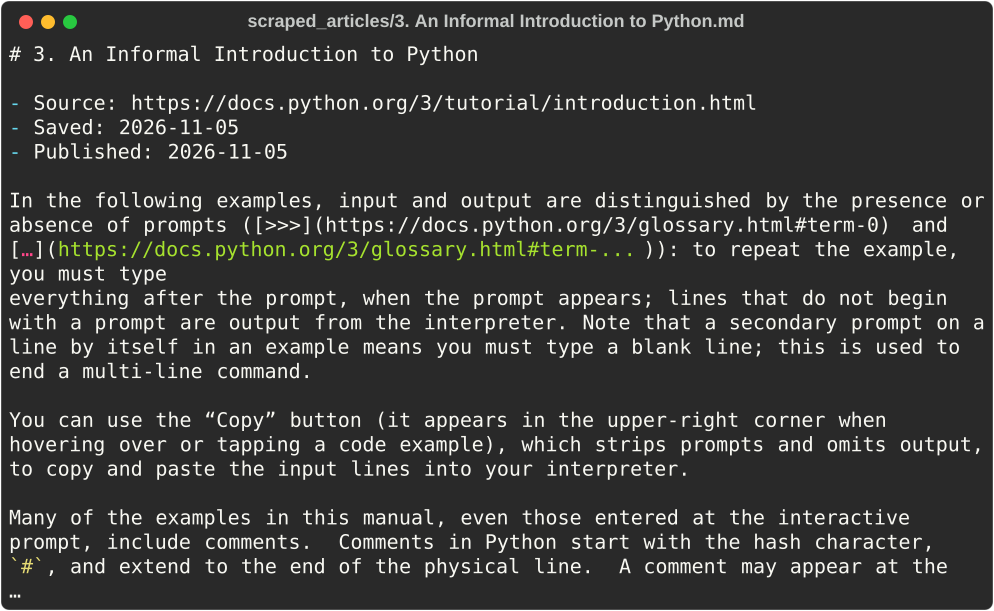
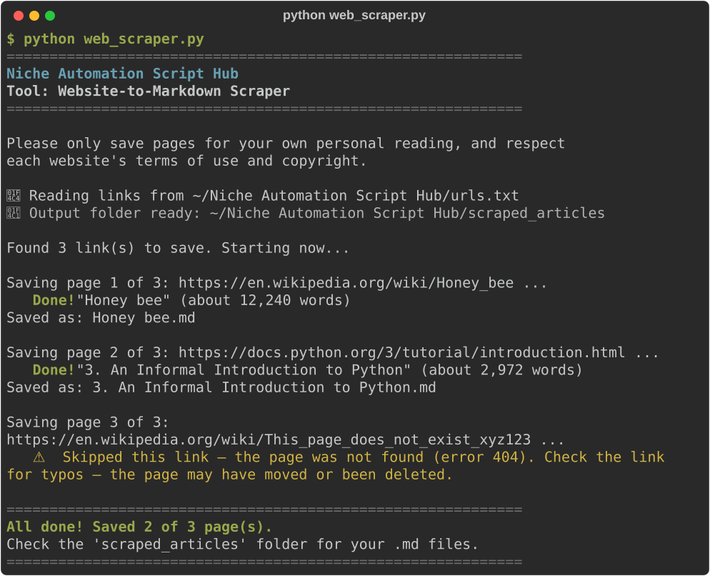

# Website-to-Markdown Scraper

**Script:** [`web_scraper.py`](../../web_scraper.py) · **Output:** `scraped_articles/`

Saves web articles as clean Markdown (`.md`) files you can read later in any notes app. It keeps the headings, paragraphs, lists, links, and tables, and throws away menus, adverts, cookie banners, sidebars, footers, and comments.



---

## How to use it

### 1. Tell it which pages to save (pick one)

- **One or two links:** type them after the script name:

  ```bash
  python web_scraper.py https://en.wikipedia.org/wiki/Honey_bee
  ```

- **A reading list:** put one link per line in `urls.txt` (the script creates this file for you the first time). Blank lines and lines starting with `#` are ignored.
- **Nothing at all:** just run `python web_scraper.py` and paste a link when asked.

You can leave out `https://` — the script adds it for you.

### 2. Watch the progress



### 3. Get your articles

Open `scraped_articles/`. Each file is named after the article's title and starts with its title, the link it came from, and the date you saved it.

Saving the same title twice never overwrites anything — you get `Title_2.md`, `Title_3.md`, and so on.

---

## Good to know

- **Sites that won't work:** pages built entirely with JavaScript (web apps and dashboards), pages behind a login or paywall, and sites that block automatic downloads (you'll see "error 403"). For these, open the page in your browser instead.
- **PDF links are skipped** — download them from your browser.
- **Wikipedia and similar pages** are sometimes saved without links, when keeping the links would make words go missing. The tool tells you when this happens.
- **Be respectful:** only save pages for your own personal reading, follow each site's terms of use and copyright, and don't republish what you save. The script waits 1 second between pages so it never floods a website.
- `urls.txt` is your personal reading list, so it is never uploaded to GitHub.

---

## Troubleshooting

| Problem | What to try |
|---------|-------------|
| `No module named 'trafilatura'` | `pip install trafilatura` or `pip install -r requirements.txt` |
| "the website refused access (error 403)" | The site blocks automatic downloads or needs a login. Open the page in your browser and copy the text yourself |
| "no article text could be found on this page" | The page is probably a JavaScript app, a login page, or a paywall. Try the site's "print" or "reader view" version, if it has one |
| "could not find this website" for every link | Check your internet connection and the spelling of the links in `urls.txt` |

---

← [Back to all tools](../../README.md#2-the-tools)
